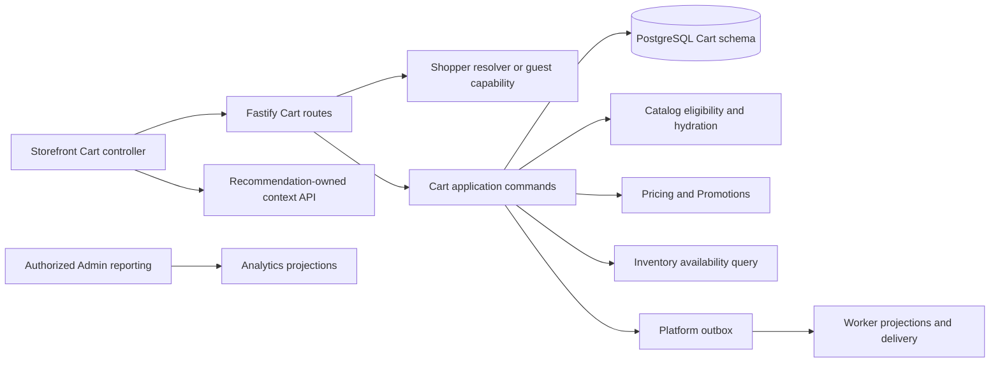

# Cart system architecture

See [Phase 03A account ownership and merge acceptance](PHASE_03A_ACCOUNT_CART_IMPLEMENTATION.md) for the implemented backend contract, tested races and open security and release gates.

> Frontend implementation notice (2026-11-03): [Phase01B-R](PHASE_01BR_IMPLEMENTATION_REPORT.md)
> and its [state/recovery contract](PHASE_01BR_STATE_AND_RECOVERY_CONTRACT.md) supersede
> unsupported-Clear/reset frontend assumptions. One controller now integrates
> the unchanged01A-R atomic Clear and cookie-forgetting API. Full account/merge,
> Checkout and complete AT/device/release acceptance are not claimed.

> Current implementation notice (2026-11-03): [Phase01A-R](PHASE_01AR_IMPLEMENTATION_REPORT.md)
> and its [API/frontend profile](PHASE_01AR_API_AND_FRONTEND_CONTRACT.md) are authoritative
> for the implemented guest foundation. Retain the full-product design below;
> fixed-cookie adoption, optional public intent keys and legacy receipt replay
> are superseded. Atomic Clear and explicit cookie-only session forgetting now
> exist. Account Carts/merge and complete Checkout are not implemented by01A-R.

Phase01A update: the [implemented profile](PHASE_01A_RECEIPT_AND_OWNER_CONTRACT.md), [bootstrap protocol](PHASE_01A_BOOTSTRAP_PROTOCOL.md) and [acceptance register](PHASE_01A_ACCEPTANCE_REGISTER.md) distinguish current code from this full-product proposal/historical design register. Only explicitly evidenced Phase01A coverage has run; other scenarios/threats remain unexecuted.

## Ownership and dependency direction

Use existing `@maevelle/contracts`, `database/cart`, security, platform and HTTP packages (audit E01–E06, E17, E38–E43, E50). Split existing `cart.ts` into focused owner-resolution, commands, queries, evaluation, receipts, merge and lifecycle files behind a compatible export facade. Transport performs TypeBox validation and server context resolution, application layer orders operations, persistence enforces constraints, frontend renders projections. Inventory/Pricing/Catalog expose batched query adapters within their own domain; Cart does not acquire a competing rule engine. Recommendation domain receives product/variant context, never reads Cart tables.

## Identity and guest capability

Resolve configured storefront organization/currency before any read or mutation. Resolve shopper realm first; Admin cookie never sufficient. Account APIs require active verified shopper and account. Anonymous requests use dedicated 32-byte cryptographic token (existing security generator), store only SHA-256 hash with tenant binding; UUID is never credential. Do not accept guest tokens in URL, browser storage, analytics or body.

Production cookie recommendation: `__Host-maevelle_cart`, Secure, HttpOnly, SameSite=Lax, Path=/, no Domain; nonproduction explicitly named insecure localhost cookie. Reader-first adoption of legacy `maevelle_cart` rotates credential after validation and expires old cookie. Same-origin `/api` proxy must preserve Set-Cookie and private headers; do not infer TLS from an attacker-controlled forwarded header. Fixed 30-day credential lifetime; no heartbeat renewal by GET. Cart activity extends intent expiry only within separately enforced credential lifetime. At expiry create fresh guest context; never expose old content without proof. Cookie restrictions produce a clear persistence-limited message and fail safely; never downgrade to a JavaScript-readable bearer token.

Mint empty guest cart only on explicit initialize/add intent with origin check and rate limit, never for crawler/header GET. GET without cookie returns an ephemeral empty view and does not write. Clearing cookies loses guest restoration; account sign-in recovers account Cart only. Offer explicit sign-in guidance, no fingerprint-based recovery. Cookie theft remains a bearer-token risk; allow rotation on suspicious lifecycle changes and revoke on merge/expiry. No guest credential grants account Cart access.

The [Phase 03A handoff](PHASE_03A_ACCOUNT_CART_HANDOFF.md) identifies the implemented owner constraints, guest-only coupling and proposed authenticated merge transaction.

## Account and frontend ownership

Account Cart references shopper account, not email or raw Admin user. One active tenant/account/currency cart; concurrent creation resolves unique conflict. Cross-device GET/focus/manual reload obtains current state; no WebSocket requirement. Every browser response is accepted only for matching owner partition, owner generation and nondecreasing revision. UI abort is advisory: it cannot undo a server commit.

Require opaque `ownerContext` precondition on mutations, derived server-side from current shopper account partition or guest cart generation (not a credential). This is vital when browser cookies change between enqueue and send: server rejects old A request carrying B cookies, not merely hides A response. On sign-in/out/switch pause queue, blank private state, resolve session, bump epoch, bind new owner, then reconcile. Never replay old account intents under a new session, and never fall back silently to guest after an account request gets 401. Sign-out starts fresh guest context and hides account Cart. Existing account changes remain on that account.

Cross-tab: BroadcastChannel carries only owner partition/revision invalidation; storage-event fallback carries no items or tokens. Receiving tab refetches its own authorized Cart, coalesces notifications and ignores mismatched partition. Cross-device: revalidate on focus/open and use bounded polling only while Cart visible (proposed 30 seconds, stop hidden/offline). No background GET writes.

## Lifecycle

| Logical state | Persistence and transition |
| --- | --- |
| New/empty | No row until explicit initialization; ACTIVE row with zero lines is empty |
| Active/populated | Persist ACTIVE, editable while valid owner/expiry |
| Inactive | Derived from last_activity_at older than 7 days; no separate ABANDONED transition required |
| Awaiting revalidation | Derived from stale evaluation TTL/fingerprint or focus; never imply stock is held |
| Invalid items | Derived per-line reasons; Cart stays ACTIVE and editable/removable |
| Expired | expires_at <= now immediately denies writes; Worker later marks EXPIRED and purges |
| Merged guest | Persist MERGED + merged_into_id/receipt; revoke capability in same transaction |
| Future converted | Preserve CONVERTED compatibility, only Orders-authorized operation may set it |

Restore inactive but unexpired Cart by authoritative read/revalidation and explicit shopper interaction; expiration never resurrects silently. Clear removes lines/coupons, increments version once, retains owner and committed receipt. Account expiry detaches old ACTIVE cart transactionally before creating replacement. Worker locks bounded candidates with SKIP LOCKED, rechecks expiry/activity under lock, never expires a refreshed row selected earlier.

## Merge protocol

Pause guest queue and drain known pending intents; resolve uncertain guest receipts before requesting merge. Server locks account-cart creation/owner row, then both Cart rows in deterministic UUID order; validate ownerContext, guest capability, expected guest and account versions. Claim merge receipt before changing anything. On stale version return 409 with safe refetch instructions; no silent repeated add under a fresh key.

Sum identical variant quantities; distinct variants remain distinct. Retain account line ID, append guest-only lines in stable guest order. Preserve requested quantities up to hard safety ceiling; lines over current stock are needs-review, not reserved. If sum exceeds 99 or union exceeds 100 lines, return merge review result without consuming guest. Review sends deterministic accepted allocations plus rejected references under new reviewed intent/version; never silently drop excess. Invalid/unpublished guest variants are carried as redacted unavailable references when within limits. No coupon union that can unexpectedly replace account choice: retain account coupon selection, list guest coupon candidates for explicit application.

Atomic commit: lines, single account revision increment, guest MERGED status, credential revocation, merge receipt and outbox. Failure rolls back all. Replayed merge with revoked guest token is allowed only via account-authorized receipt lookup bound to the original account; guest token alone returns generic unavailable. Lost response retrieves receipt before fresh account view. Concurrent edits yield deterministic conflict. Interrupted transaction cannot leave partial ownership. Partial reconciliation is a reviewed result, not partial transaction corruption. The UX explicitly lists retained, combined, unavailable and excluded quantities.

## Failure isolation

All authoritative mutation effects and minimal domain event commit together. Event delivery, Recommendations, GA4/Meta, aggregate dashboards and optional background cleanup never gate a successful Cart response. Database/protection-store outage returns safe 503 and Retry-After, retaining pending intent; do not report empty Cart or success. Deterministic lock ordering, bounded lock/statement timeouts and finite server retries for transaction serialization failures protect pool capacity. External calls never occur under Cart locks.

## Explicit unresolved initialization gate

D15/S59 covers simultaneous cookie-less tabs and delayed initialization Set-Cookie. A cookie initialization receipt cannot safely be replayed to an unauthenticated caller solely from Idempotency-Key. Creation retries without proof may leave empty orphan rows for bounded cleanup, but must not lose acknowledged populated shopping intent. Recommended protocol begins with browser-wide initialization coordination, verified cookie round trip and owner-fenced commands. The fallback when coordination APIs are unavailable must be resolved with barriers/browser evidence in 01A/01B; this plan does not present that unproven fallback as solved.

Identity integration also requires typed resolution: legitimate absence differs from expired account context or authentication storage failure. Existing `.catch(() => null)` at the shopper resolver (E23) cannot by itself satisfy fail-closed Cart behavior. Account ownerContext plus recognizable shopper session requests must return unavailable/reauthentication rather than creating a guest Cart on infrastructure errors (D16).
