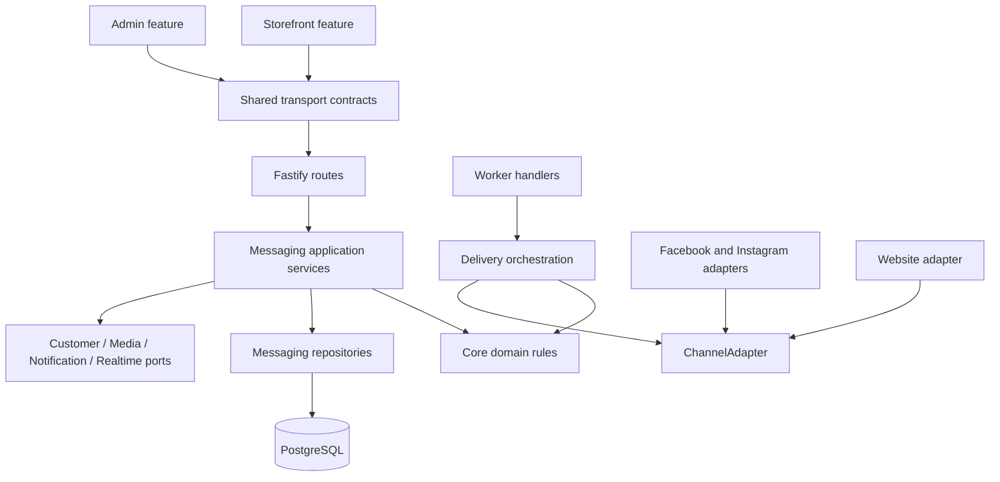
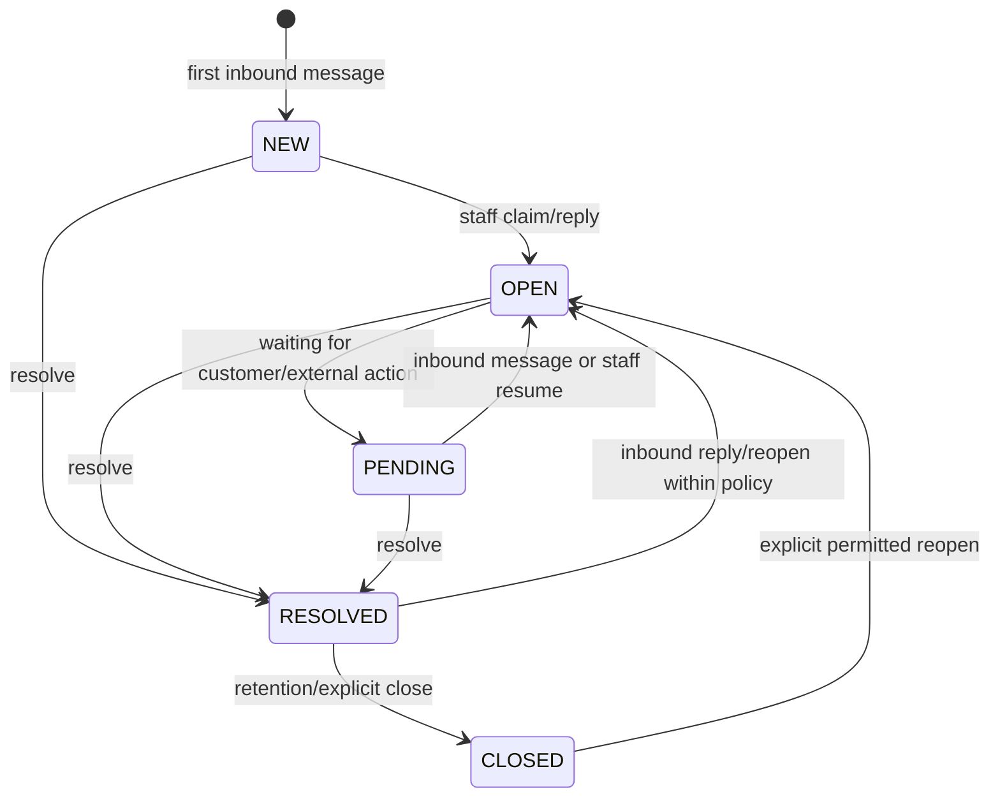
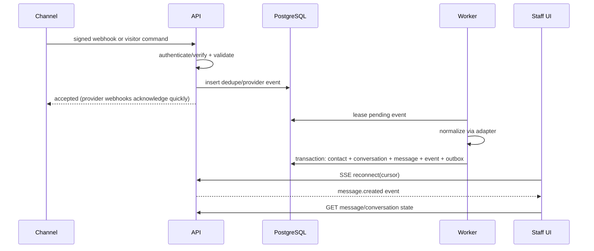
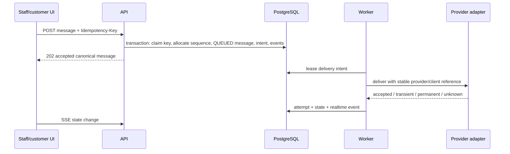

# Requirements and System Architecture

## Scope and quality attributes

The module provides native Storefront live chat, one unified staff inbox, and official Facebook/Instagram adapters. It must preserve messages through restarts/outages, isolate organizations and private content, support simultaneous staff, work on phones/tablets, and remain operable on the current single-VPS topology.

Excluded from Phases 01–09: AI generation/summaries/agents, vector stores, WhatsApp, TikTok, email ticketing, and calls. The core exposes read-authorized query/service contracts so future extensions do not require direct table access.

## Bounded modules

| Module | Owns | Does not own |
|---|---|---|
| `messaging/core` | contacts, identities, conversations, participants, messages, notes, tags, lifecycle and policy | Provider HTTP or UI |
| `messaging/delivery` | outbound intents, attempts, retry classification, reconciliation | Provider-specific payload shape |
| `messaging/realtime` | persisted event log, authorization, SSE replay and ephemeral signal fan-out | Business state |
| `messaging/storefront` | visitor credential/session, website capability adapter, business-hours behavior, page/product context | Customer authentication or order truth |
| `messaging/operations` | assignment, availability, saved replies, settings, reporting projections | IAM membership lifecycle |
| `messaging/providers/meta` | Facebook/Instagram normalization, eligibility, tokens, signatures, errors, external IDs | Canonical conversation rules |
| customer context port | authorized customer/order summary assembled from existing services | Customer/order persistence |
| media port | private upload/download/retention integration | Public catalog media policy |
| notification port | staff attention notifications | Chat transcript |

Dependency direction:



Provider adapters depend on core contracts; core never imports Meta/website implementations.

## Core concepts

- **Channel connection:** one configured Maevelle endpoint, such as the public Storefront chat, one Facebook Page, or one Instagram professional account.
- **Contact:** organization-owned support identity that may have several channel-qualified identities and an optional verified/audited link to a canonical Maevelle customer.
- **Conversation:** one operational thread on one connection and one channel identity. A customer can have multiple conversations and identities.
- **Participant:** staff/contact/system membership in a conversation. Assignee is an operational pointer to a staff membership, not ownership of history.
- **Message:** immutable canonical content envelope ordered by conversation sequence. Delivery/read/edit/retraction changes are separate state/events.
- **Internal note:** staff-only timeline item; never passed to a channel adapter.
- **Realtime event:** compact persisted fact allowing clients to invalidate/reconcile state. Message content is fetched through authorized queries.

## Conversation lifecycle

Canonical status is one of `NEW`, `OPEN`, `PENDING`, `RESOLVED`, `CLOSED`.



`priority` (`LOW`, `NORMAL`, `HIGH`, `URGENT`), `is_starred`, unread state, assignment, and provider reply eligibility are independent dimensions—not additional statuses. A valid inbound customer message reopens `RESOLVED` to `OPEN`; a reply to `CLOSED` creates a new conversation unless channel policy explicitly reopens it.

Every status transition appends an operational event and audit event. `version` is required for conditional Admin mutations.

## Channel capability contract

```ts
interface ChannelCapabilities {
  readonly text: { maxLength: number } | false;
  readonly attachments: false | {
    readonly mimeTypes: readonly string[];
    readonly maxBytes: number;
    readonly maxCount: number;
  };
  readonly reactions: 'NONE' | 'READ_ONLY' | 'CREATE_REMOVE';
  readonly edits: 'NONE' | 'PROVIDER_ONLY' | 'BIDIRECTIONAL';
  readonly retractions: 'NONE' | 'PROVIDER_ONLY' | 'BIDIRECTIONAL';
  readonly readReceipts: 'NONE' | 'OUTBOUND' | 'BIDIRECTIONAL';
  readonly typing: 'NONE' | 'OUTBOUND' | 'BIDIRECTIONAL';
  readonly replyWindow: { kind: 'UNLIMITED' } | {
    kind: 'UNTIL';
    expiresAt: string;
    reason: string;
  };
}

interface ChannelAdapter {
  readonly kind: 'WEBSITE' | 'FACEBOOK' | 'INSTAGRAM';
  capabilities(context: ConversationDeliveryContext): Promise<ChannelCapabilities>;
  deliver(command: DeliverMessageCommand): Promise<DeliveryOutcome>;
  reconcile(input: ReconcileDeliveryInput): Promise<ReconciliationOutcome>;
  normalizeInbound(input: UntrustedProviderEvent): Promise<NormalizedInboundEvent[]>;
}
```

Unsupported operations fail before a delivery intent is accepted with `CHANNEL_CAPABILITY_UNSUPPORTED` or `REPLY_WINDOW_CLOSED`. Capabilities are returned with each conversation so UIs disable/hide controls with an explanatory reason, but backend enforcement remains authoritative.

## Primary service contracts

The implementation may use functions rather than classes, consistent with the database package, but these responsibilities remain separate:

- `acceptInboundMessage`: deduplicate provider/client input, resolve contact/conversation, allocate sequence, persist message, update conversation, append outbox/realtime events atomically.
- `prepareOutboundMessage`: authorize, validate capability/reply window/content, atomically claim idempotency key, allocate sequence, persist queued message/delivery intent/outbox.
- `transitionConversation`: enforce state machine and optimistic version.
- `assignConversation`: conditional claim/reassign with history and audit.
- `markConversationRead`: upsert membership read cursor monotonically.
- `linkContactToCustomer`: require proof/elevated permission and preserve link history.
- `deliverPendingMessage`: lease intent, invoke adapter, persist attempt and state, schedule retry/reconciliation.
- `publishRealtimeEvent`: append compact event inside the originating transaction.
- `queryCustomerContext`: call existing customer/order services after `messaging.customer_context.view` authorization.

## Major flows

### Inbound provider or website message



Website commands may normalize synchronously in Phase 02, but use the same transaction. Meta webhooks are durably recorded then acknowledged before processing.

### Outbound message



Website staff-to-customer messages can be marked `DELIVERED` once available to an authorized visitor stream; `READ` requires a visitor read cursor. Meta states are only advanced when official responses/events support them.

## Customer context boundary

Messaging stores only `customer_id` links and selected immutable context snapshots attached to individual messages (for example product page URL/title/variant at initiation). Current customer/order/delivery truth comes from existing services. The inbox requests a bounded `CustomerContextView`; it does not join arbitrary commerce tables into the conversation query.

## Multi-agent concurrency

- Claim uses `UPDATE ... WHERE assignee_membership_id IS NULL AND version = :expected RETURNING`; one winner, loser gets `409 ASSIGNMENT_CONFLICT` with current state.
- Reassignment requires `messaging.assign` and expected version.
- Message inserts serialize briefly on the conversation row to allocate the next sequence. They do not hold locks across provider calls.
- Resolve/assign/priority mutations use optimistic versioning.
- A new inbound message and resolve operation serialize on the conversation row; the final rule is that unread inbound activity leaves the conversation `OPEN`.
- Staff session expiry closes/rejects commands; already persisted outbound intents continue because authorization was captured and audited at acceptance.
