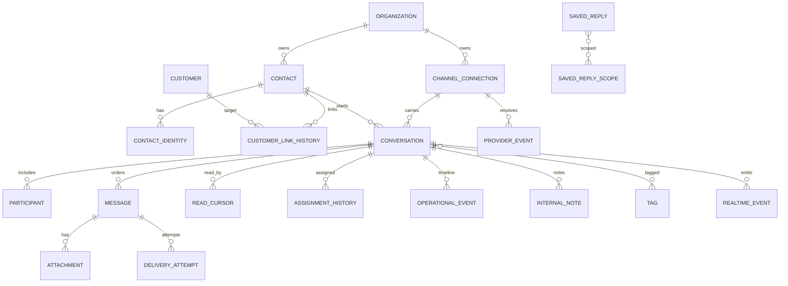

# Database Design

## Conventions

- New schema: `messaging`; PostgreSQL 18; lowercase snake case; `uuidv7()` opaque UUIDs; `timestamptz`; `text` plus checks for evolving business states.
- Every tenant-owned table carries `organization_id`. Parent tables expose `unique (organization_id, id)` and children use composite FKs to prevent cross-tenant references.
- Mutable aggregate rows carry `version bigint not null default 1`.
- Provider identifiers are `text`, never assumed numeric/UUID or globally unique.
- JSONB is limited to provider/capability/context payloads; queryable core state is relational.
- No partitioning initially. Revisit event/message partitioning only after measured scale (approximately 100M rows or retention operations requiring it).
- No automatic destructive `down` migration for conversation history.

## Entity relationship model



## Phase 01 core tables

### `messaging.channel_connections`

One configured channel endpoint.

| Column | Type / rule |
|---|---|
| `id` | uuid PK default `uuidv7()` |
| `organization_id` | uuid NOT NULL FK organization |
| `channel_kind` | text NOT NULL check `WEBSITE`, `FACEBOOK`, `INSTAGRAM` |
| `display_name` | text NOT NULL, trimmed, 1–160 chars |
| `status` | text NOT NULL check `DRAFT`, `ACTIVE`, `DEGRADED`, `DISCONNECTED`, `DISABLED` |
| `provider_account_id` | text nullable; populated by external adapters |
| `integration_account_id` | uuid nullable FK `integrations.integration_accounts` |
| `capability_snapshot` | jsonb object NOT NULL default `{}`; advisory cache, not authorization truth |
| `configuration` | jsonb object NOT NULL default `{}`; non-secret settings only |
| `last_healthy_at`, `last_error_at` | timestamptz nullable |
| `last_error_code` | text nullable; no secret/provider body |
| `created_at`, `updated_at`, `version` | standard |

Constraints/indexes: unique `(organization_id,id)`; unique `(organization_id,channel_kind,provider_account_id)` where provider ID is present; index organization/status/kind. Phase 01 creates the core shape; Phase 02 creates/configures the website connection; Phases 06/08 populate provider fields.

### `messaging.contacts`

Channel-agnostic support contact, not a replacement customer.

Columns: `id`, `organization_id`, `display_name` nullable, `customer_id` nullable organization-qualified FK to `customers.customers`, `link_status` (`UNLINKED`, `LINKED`, `DISPUTED`, `UNLINKED_BY_POLICY`), `linked_at`, `linked_by_actor_id`, `created_at`, `updated_at`, `version`. A customer may have many contacts; a contact links to at most one customer.

Indexes: `(organization_id, customer_id, updated_at desc)` partial when linked; `(organization_id, lower(display_name))` when present.

### `messaging.contact_identities`

Columns: `id`, `organization_id`, `contact_id`, `channel_kind`, `channel_connection_id`, `external_subject_id` text, `display_name`, `username`, `avatar_url` (provider reference only), `verification_status` (`CHANNEL_ASSERTED`, `MAEVELLE_VERIFIED`, `UNVERIFIED`, `REVOKED`), `profile_metadata` jsonb object, `first_seen_at`, `last_seen_at`, `created_at`, `updated_at`.

Unique `(organization_id, channel_connection_id, external_subject_id)` prevents one provider identity mapping to two contacts. Index contact and last-seen. Website `external_subject_id` is a random visitor ID, not a cookie token. Meta values are provider-scoped IDs.

### `messaging.contact_customer_link_events`

Immutable evidence: `id bigint identity PK`, `organization_id`, `contact_id`, `customer_id`, `action` (`LINKED`, `UNLINKED`, `REJECTED`), `method` (`AUTHENTICATED_ACCOUNT`, `VERIFIED_EMAIL`, `VERIFIED_PHONE`, `STAFF_REVIEW`, `CUSTOMER_MERGE`, `PRIVACY_ACTION`), `actor_type`, `actor_id`, `evidence_reference` nullable, `reason` nullable, `created_at`. Index contact/time and customer/time. Never store OTPs or raw credential material.

### `messaging.conversations`

| Column | Type / invariant |
|---|---|
| `id` | uuid PK |
| `organization_id` | tenant FK |
| `channel_connection_id` | organization-qualified FK |
| `contact_id` | organization-qualified FK |
| `contact_identity_id` | organization-qualified FK |
| `provider_conversation_id` | text nullable |
| `status` | `NEW`, `OPEN`, `PENDING`, `RESOLVED`, `CLOSED` |
| `priority` | `LOW`, `NORMAL`, `HIGH`, `URGENT`; default `NORMAL` |
| `assignee_membership_id` | uuid nullable FK IAM membership |
| `assigned_at`, `assigned_by_membership_id` | nullable |
| `is_starred` | boolean default false |
| `next_message_sequence` | bigint NOT NULL default 1, check > 0 |
| `last_message_sequence` | bigint NOT NULL default 0 |
| `last_message_id` | uuid nullable (FK added after message table, deferrable) |
| `last_message_at`, `last_inbound_at`, `last_outbound_at` | timestamptz nullable |
| `resolved_at`, `closed_at` | timestamptz nullable, consistent with status |
| `reply_eligible_until` | timestamptz nullable provider projection |
| `subject` | text nullable, 1–240 trimmed |
| `context` | jsonb object NOT NULL default `{}`; bounded page/product initiation context |
| `created_at`, `updated_at`, `version` | standard |

Uniqueness: provider thread unique by connection when present. Website supports one active conversation per `(connection, contact_identity)` using a partial unique index on statuses `NEW/OPEN/PENDING/RESOLVED`; closed conversations may coexist. Indexes:

- inbox: `(organization_id,status,last_message_at desc,id desc)`;
- mine: `(organization_id,assignee_membership_id,status,last_message_at desc,id desc)`;
- unassigned partial `(organization_id,last_message_at desc,id desc) where assignee_membership_id is null and status in (...)`;
- channel/filter `(organization_id,channel_connection_id,status,last_message_at desc,id desc)`;
- contact `(organization_id,contact_id,last_message_at desc)`.

### `messaging.messages`

| Column | Type / invariant |
|---|---|
| `id` | uuid PK |
| `organization_id`, `conversation_id` | organization-qualified FK |
| `sequence` | bigint NOT NULL > 0; unique per conversation |
| `direction` | `INBOUND`, `OUTBOUND`, `INTERNAL` |
| `sender_type` | `CONTACT`, `STAFF`, `SYSTEM`, `PROVIDER` |
| `sender_membership_id` | nullable IAM membership; required for staff sender |
| `sender_contact_identity_id` | nullable; required for contact sender |
| `message_type` | `TEXT`, `ATTACHMENT`, `MIXED`, `SYSTEM_EVENT` |
| `text_body` | text nullable; trimmed; channel-specific max enforced in application |
| `structured_payload` | jsonb object NOT NULL default `{}`; normalized non-secret structured content |
| `provider_message_id` | text nullable |
| `client_message_id` | text nullable, <= 160 |
| `reply_to_message_id` | uuid nullable organization-qualified FK |
| `delivery_state` | `RECEIVED`, `QUEUED`, `SENDING`, `SENT`, `DELIVERED`, `READ`, `FAILED_TRANSIENT`, `FAILED_PERMANENT`, `UNKNOWN` |
| `provider_created_at` | timestamptz nullable evidence |
| `accepted_at`, `sent_at`, `delivered_at`, `read_at`, `failed_at` | timestamptz as applicable |
| `failure_code`, `failure_summary` | nullable; sanitized |
| `edited_at`, `retracted_at` | nullable; content remains subject to retention/audit policy |
| `created_at`, `updated_at` | standard |

Checks require content or attachment expectation, valid sender columns, and monotonic terminal timestamps where feasible. Unique `(conversation_id,sequence)`; unique `(organization_id,channel_connection_id,provider_message_id)` is implemented through a separate external-reference table or denormalized connection ID—preferred table below avoids duplicating connection ID. Unique `(organization_id,conversation_id,client_message_id)` where present. Index `(organization_id,conversation_id,sequence desc)` covers history; `(organization_id,delivery_state,created_at)` partial for active outbound states.

### `messaging.message_external_references`

`id`, `organization_id`, `message_id`, `channel_connection_id`, `reference_type` (`PROVIDER_MESSAGE`, `CLIENT_MESSAGE`, `ECHO_MESSAGE`), `external_id`, `created_at`; unique `(organization_id,channel_connection_id,reference_type,external_id)` and `(message_id,reference_type,external_id)`. This is the authoritative provider dedupe key.

### `messaging.realtime_events`

`id bigint generated always as identity PK` is the global replay cursor; `event_id uuid unique`, `organization_id`, `audience_type` (`CONVERSATION`, `MEMBERSHIP`, `ORGANIZATION`, `VISITOR`), `audience_id`, `conversation_id` nullable, `event_type`, `event_version`, `aggregate_id`, `aggregate_version`, `payload` jsonb object (identifiers and changed fields only), `created_at`, `expires_at`.

Indexes `(organization_id,id)`, `(organization_id,audience_type,audience_id,id)`, `(expires_at)`. Retain at least seven days; clients beyond retention receive `410 EVENT_CURSOR_EXPIRED` and refetch current state.

### `messaging.delivery_intents` and `messaging.delivery_attempts`

Intent: `id`, organization/message/connection FKs, `status` (`PENDING`, `PROCESSING`, `RETRY_WAIT`, `SUCCEEDED`, `FAILED_FINAL`, `RECONCILIATION_REQUIRED`), `available_at`, `lease_owner`, `lease_expires_at`, `attempt_count`, `max_attempts`, `last_error_code`, `provider_request_key`, timestamps. Unique message ID (one delivery intent per outbound channel message). Claim index on status/available/ID and expired lease index.

Attempt: bigint identity PK, organization/intent/message, attempt number, outcome (`ACCEPTED`, `TRANSIENT_FAILURE`, `PERMANENT_FAILURE`, `UNKNOWN`), provider status/code/request ID, sanitized error, started/completed times, latency milliseconds, response metadata jsonb without secrets/content. Unique `(intent_id,attempt_number)`.

## Phase 02 website identity tables

### `messaging.visitor_sessions`

`id uuid PK` (public visitor ID), `organization_id`, `contact_identity_id`, `credential_digest bytea` (HMAC/slow hash of 256-bit random secret; never plaintext), `status` (`ACTIVE`, `ROTATED`, `REVOKED`, `EXPIRED`), `issued_at`, `last_seen_at`, `expires_at`, `rotated_to_session_id` nullable, `revoked_at`, `revocation_reason`, `created_at`. Index active expiry and identity. The browser stores `visitorId.secret` in an HttpOnly Secure SameSite=Lax cookie; the database stores only digest.

### `messaging.conversation_context_events`

Optional bounded history of customer-provided page/product context: identity/time plus `context_type`, validated `url_path`, catalog `product_id`/`variant_id` nullable, title snapshot, and metadata. No arbitrary HTML/referrer query strings.

## Phase 04 operational tables

- `conversation_read_cursors`: composite PK `(organization_id,conversation_id,reader_type,reader_id)`; `reader_type` check `MEMBERSHIP|CONTACT_IDENTITY`, `last_read_sequence bigint not null default 0 check >= 0`, `updated_at`. Conversation FK; indexes reader/time and conversation/sequence. Upsert may only increase the cursor.
- `conversation_assignment_events`: bigint identity PK; organization/conversation FKs; nullable old/new IAM membership IDs; required actor membership, `reason text`, `conversation_version bigint`, `created_at`. Index conversation/time and new-assignee/time. Immutable.
- `conversation_events`: bigint identity PK; organization/conversation FKs; `event_type text`, nullable actor membership, `from_value/to_value jsonb`, `reason`, `created_at`; index conversation/time and organization/type/time. Values are bounded by application schemas.
- `internal_notes`: UUID PK; organization/conversation FK; `author_membership_id uuid not null`, `body text not null` with trimmed length 1–10,000, `revision integer default 1`, nullable `superseded_by_note_id`, `deleted_at/deleted_by/reason`, timestamps. Index conversation/time; edits append or supersede rather than erase evidence.
- `tags`: UUID PK; organization FK; `label text not null`, `color_token text`, `status ACTIVE|ARCHIVED`, timestamps/version; case-insensitive unique organization label. `conversation_tag_assignments` has composite PK `(organization_id,conversation_id,tag_id)`, assigner/time and organization-qualified FKs; index tag/conversation activity.
- `saved_replies`: UUID PK; organization FK; `title/body text not null` with length checks, nullable normalized `shortcut`, `status ACTIVE|ARCHIVED`, creator/updater membership IDs, timestamps/version; unique active shortcut per organization. `saved_reply_scopes` composite PK `(saved_reply_id,scope_type,scope_id)` with `scope_type CHANNEL_KIND|CONNECTION`; application verifies scope target. Index active title/shortcut.
- `business_hours`: UUID PK; one row per organization/connection (`connection_id` nullable for default, unique nulls-not-distinct), IANA `timezone text`, `weekly_schedule jsonb` strict object, `offline_accepts_messages boolean default true`, nullable saved-reply reference, timestamps/version. `business_hour_exceptions`: UUID PK, parent FK, `local_date date`, optional open/close local times, `is_closed`, label; unique parent/date and consistency check.
- `agent_availability`: composite PK organization/membership; `status ONLINE|BUSY|AWAY|OFFLINE`, `capacity integer check 0..100`, `manual_override_until`, `last_heartbeat_at`, `updated_at`, version. Index organization/status/heartbeat. Advisory for routing, never authorization.
- `assignment_rules`: UUID PK; organization FK; `name`, `position integer >= 0`, `is_enabled`, strict `conditions/actions jsonb` objects, timestamps/version; unique organization/position and index enabled order. Deterministic first-match evaluation.
- Organization defaults such as reopen window, retention, attachment policy and notification behavior use the existing versioned `platform.configuration_values`/central settings service under `messaging.*` keys; do not create a competing generic settings table.
- `reporting_daily`: UUID PK; organization/connection FKs; `report_date date not null`; nullable `assignee_membership_id` where null is the channel total; non-negative bigint counts; non-negative duration sums/counts; `updated_at`. Unique `(organization_id,report_date,channel_connection_id,assignee_membership_id) nulls not distinct`; indexes date/channel and date/assignee. Rebuildable from immutable events; it is not business truth.

Conversation unread counts are derived from `last_message_sequence - read_cursor` with inbound-direction filtering in queries. Do not maintain a single shared unread counter that races between agents.

## Phase 06/08 provider tables

### `messaging.provider_events`

Durable inbox: `id`, organization/connection, provider, `provider_event_id` nullable, `dedupe_hash` bytea NOT NULL, `event_type`, `api_version`, `payload_ciphertext` bytea or access-controlled JSONB according to credential encryption utility, `signature_verified_at`, `received_at`, `status` (`RECEIVED`, `PROCESSING`, `PROCESSED`, `RETRY_WAIT`, `DEAD_LETTER`, `IGNORED`), lease/retry/error fields, `processed_at`. Unique `(connection_id,provider_event_id)` where present and `(connection_id,dedupe_hash)`. Raw payload has short retention after normalized persistence.

Provider credentials remain in `integrations.provider_credentials`; messaging stores only `integration_account_id`. `integrations.external_entity_mappings` may map provider account resources, while message/contact mappings remain in messaging because they participate in messaging idempotency.

## Attachments

`messaging.message_attachments`: UUID PK; `organization_id`, organization-qualified `message_id`; nullable `media_asset_id` FK existing media asset; `position integer not null check >= 0`; `kind` (`IMAGE`, `VIDEO`, `AUDIO`, `FILE`, `STICKER`, `PROVIDER_SHARE`); nullable filename/MIME; `byte_size bigint check >= 0`; nullable non-negative width/height/duration; `security_status` (`UPLOADING`, `QUARANTINED`, `AVAILABLE`, `REJECTED`, `PURGED`, `REMOTE_ONLY`); provider reference metadata JSON object; nullable expiry/purge timestamps; `created_at`. Unique `(message_id,position)`; indexes media asset and purge status/time. Phase 01 creates the relationship/state table; Phase 02 implements website upload authorization/processing.

An attachment is downloadable only when `AVAILABLE` and the caller can access its conversation. Provider URLs are never treated as permanent or exposed directly when Maevelle can safely ingest a copy.

## Sequence allocation transaction

```sql
update messaging.conversations
set next_message_sequence = next_message_sequence + 1,
    last_message_sequence = next_message_sequence,
    version = version + 1,
    updated_at = now()
where organization_id = $1 and id = $2
returning next_message_sequence - 1 as allocated_sequence, version;
```

The transaction then inserts message, external reference/idempotency evidence, updates last-message projections, inserts realtime/outbox events, and commits. Provider network calls occur after commit. A conversation-row lock gives strict per-conversation order; no global serialization exists.

## Retention and deletion

- Default conversation/message retention: configurable, recommended 24 months pending legal/business approval.
- Audit, customer link evidence, and delivery metadata may outlive message content.
- Visitor sessions expire after 180 days of inactivity by default; rotate on authentication/linking and suspected theft.
- Realtime events: seven days minimum; raw provider payload: 30 days maximum unless needed for an open exception.
- Attachments follow the conversation policy and are purged through existing media jobs.
- Customer anonymization unlinks/obfuscates contact profile data when legally permitted but does not silently corrupt required commercial/audit evidence.
- Hard deletion is an explicit privacy workflow with hold checks, not `ON DELETE CASCADE` from customer. Core history FKs generally `RESTRICT`; optional links use `SET NULL` only when history remains intelligible.

## Migration ownership

| Phase | Baseline responsibility |
|---|---|
| 01 | schema, connections, contacts/identities/link events, conversations, messages/references, realtime events, delivery intents/attempts, core capabilities |
| 02 | visitor sessions, website configuration/context, website connection seed |
| 04 | read cursors, assignment/events, notes, tags, saved replies, business hours, availability/rules/reporting |
| 06 | provider inbox and Facebook-specific connection metadata/indexes |
| 08 | Instagram-specific connection metadata/indexes; reuse provider inbox |

Because the repository is in mutable-baseline development mode, implement these in the relevant existing/new domain baseline migrations rather than additive repair ALTER files. A fresh database must build. No production backfill is planned; if a durable environment exists by implementation time, freeze this plan and write forward-only migrations instead.

Unless a table says otherwise, tenant parents use `ON DELETE RESTRICT`; ephemeral child rows use explicit retention jobs rather than cascades; nullable external links may use `ON DELETE SET NULL` only when the remaining evidence is meaningful. Every FK column used for joins/deletion checks receives an index. All JSON columns check their top-level type. All collection access is organization-qualified and bounded.
