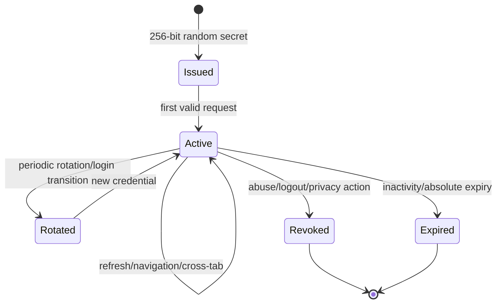

# Realtime, Reliability, Identity, and Security

## Realtime decision

Use HTTP commands/queries plus SSE for server-to-browser updates. SSE fits the dominant traffic shape, reconnects natively, traverses current Caddy/HTTPS topology, and needs no new broker. Typing/presence requests remain short HTTP commands or optional ephemeral SSE fan-out.

Rejected for now:

- WebSockets: bidirectional state, proxy/time-out/heartbeat complexity, and custom replay add cost without a required use case.
- Polling only: simpler but causes avoidable latency/load for an operational inbox.
- Redis/pub-sub/broker: adds an operational dependency and still needs durable replay.
- PostgreSQL `LISTEN/NOTIFY` as truth: useful only as an optional wake-up hint; payloads are transient and do not replace `realtime_events`.

In a single API process, an in-memory subscriber registry wakes matching SSE connections after commit. A short database poll catches commits from workers and missed process-local wakes. On future multi-replica deployment, add `LISTEN/NOTIFY` or a broker only as a hint; cursor replay remains authoritative.

## Delivery semantics and ordering

- HTTP acceptance is exactly one canonical message per `(organization, principal, operation, idempotency key/fingerprint)` enforced by a unique constraint.
- Provider/webhook processing is at-least-once. Unique external references/dedupe hashes make normalization idempotent.
- Network delivery is at-least-once or unknown. Maevelle never claims exactly once.
- Canonical per-conversation order is the allocated integer sequence, not arrival clock/provider timestamp.
- Provider message order is retained as evidence in `provider_created_at`; late events receive the next Maevelle sequence and may show a provider-time indicator if needed.
- Outbound status advances monotonically except an explicit reconciliation correction event. `UNKNOWN` is not treated as safe-to-retry until adapter policy or reconciliation establishes the result.

## Retry model

Classification is adapter-owned but normalized:

- transient: connection reset before known acceptance, 429 with Retry-After, supported 5xx; exponential backoff with full jitter, e.g. 5s, 30s, 2m, 10m, 1h, bounded by `max_attempts` and provider window;
- permanent: invalid recipient, permission revoked, reply window closed, unsupported content, explicit provider rejection;
- unknown: timeout/connection loss after request may have reached provider. Reconcile by stable request/reference or wait for echo webhook; do not blindly duplicate;
- dead-letter: attempts exhausted or unparseable event. Visible in operations with redacted diagnostics and a controlled retry after correction.

Worker leases recover after process death. No database lock is held during external HTTP. Each attempt is recorded before/after the call, and state/event updates are transactional.

## Guest identity lifecycle

Credential format: opaque visitor UUID plus 32 random bytes. Store only a keyed digest; compare in constant time. Set as `HttpOnly; Secure; SameSite=Lax; Path=/api/storefront/v1/chat`; avoid localStorage/sessionStorage for the secret. The browser may store non-sensitive UI state such as launcher open/closed separately.

The credential grants access only to its contact identity and conversations in the resolved Storefront organization. It grants no customer/order context. Cross-tab continuity comes from the cookie and BroadcastChannel notification hints. Cross-device continuity requires authenticated customer linkage or a separate verified recovery flow—typing an email/phone is insufficient.

On login, if `customers.customer_accounts` proves the authenticated user/customer relationship, rotate the visitor credential and link the messaging contact in a transaction. If the account is linked to a different contact, preserve both contact identities and create an auditable merge/link review rather than silently merging transcripts.

## Authorization policy

Proposed capability definitions:

| Capability | Meaning |
|---|---|
| `messaging.inbox.view_assigned` | See assigned/claimed conversations |
| `messaging.inbox.view_all` | See organization inbox |
| `messaging.reply` | Send channel replies where conversation is accessible |
| `messaging.claim` | Claim unassigned work |
| `messaging.assign` | Assign/reassign other staff |
| `messaging.status.manage` | Pending/resolve/close/reopen |
| `messaging.priority.manage` | Priority/star controls |
| `messaging.notes.create` / `.manage_all` | Internal note authoring/supervision |
| `messaging.tags.manage` | Tags and assignments |
| `messaging.contacts.search` | Search contact identity |
| `messaging.customer_context.view` | View linked customer/order context |
| `messaging.customer_link.manage` | Link/unlink contact and customer |
| `messaging.saved_replies.use` / `.manage` | Use/manage reply library |
| `messaging.reports.view` | Operational reporting |
| `messaging.settings.manage` | Hours/rules/retention |
| `messaging.connections.view` / `.manage` | Provider state vs OAuth/secrets/disconnect |

Owners receive capabilities through the existing grant convention. Standard memberships must be granted explicitly. `view_assigned` also requires the membership to be the assignee or an authorized participant; `view_all` bypasses assignment filtering within the organization only. Customer context requires both conversation access and the specific context capability.

## Trust boundaries and controls

### Public Storefront

- Resolve organization from server configuration, never request body.
- Layer IP + visitor + conversation rate limits: session creation 10/hour/IP, message 30/minute/visitor and 120/hour/conversation, upload 10/hour/visitor; tune from observed abuse.
- Limit text, Unicode-normalize, reject control characters and oversized structured context. Render as text, never raw HTML.
- CSRF protection comes from SameSite cookie plus same-origin checks/custom header on mutations; CORS allowlist remains narrow.
- Honeypot/risk throttling can be added; CAPTCHA is escalation, not the only defense.
- Opaque IDs plus authorization; unauthorized and absent resources both return 404 where enumeration is possible.

### Staff/Admin

- Better Auth session, active membership, capability and assignment policy on every endpoint/SSE subscription.
- Existing origin protection extends to `/admin/messaging/*`.
- Sensitive mutations are audited with request ID, actor, target, before/after; message body is excluded from generic audit metadata.
- Session expiration immediately stops SSE/commands. Durable commands already accepted may complete.

### Provider webhook/OAuth

- Verify GET challenge token and POST HMAC signature over exact raw bytes using constant-time comparison before parsing effects.
- Accept only configured app/connection/account IDs; reject cross-connection payloads.
- OAuth state is random, single-use, short-lived, tied to organization/membership/redirect; use PKCE when supported.
- Encrypt access/refresh tokens with existing credential encryption; never return/log them. Track granted scopes, issued/expiry/check time, revocation and rotation.
- Validate all third-party response/event shapes and Graph API versions. Bound payload sizes before durable storage.

### Attachments

- Allowlist MIME and verify magic bytes; ignore filename extensions; sanitize names.
- Initial recommended website policy: JPEG/PNG/WebP/PDF, 10 MiB each, maximum 5; expand only with security/UX need.
- Upload to private bucket with random key. Quarantine until checksum, type inspection, image decode/re-encode and malware scanning policy complete. If no scanner exists, restrict allowed types and mark the operational gap explicitly.
- Strip image metadata, generate safe preview, prevent SVG/HTML/scriptable formats initially.
- Download through short-lived signed URL issued after conversation authorization; set content disposition and no-sniff.
- Prevent SSRF when fetching provider media: adapter-controlled HTTPS hosts/redirect limits, DNS/IP checks, size/time limits; preferably use provider-authenticated fetches.

## Privacy and integrity

- Data minimization: provider payload snapshots are short-lived; normalized fields are retained. Do not copy entire customer/order records into messages.
- Staff notifications contain safe preview text only if the recipient opted in; lock-screen/browser notification defaults should avoid message content.
- Structured logs include IDs, channel, state, attempt, latency, request/correlation IDs—not body, attachment URL, email/phone, token, cookie, signature or raw payload. Extend observability redaction for `message`, `text`, `body`, `providerPayload`, `visitorSecret`, and signature headers.
- Backups include messaging tables/private objects under existing backup controls; restore drills must eventually verify referential linkage and object availability.
- Retention, access/export/deletion obligations under Bangladesh law and Meta platform terms require legal/policy approval before production. The architecture supports configurable retention, hold checks, export, unlink/anonymize and audited deletion but this document is not legal advice.

## Failure scenarios

| Scenario | Required behavior |
|---|---|
| Duplicate client send | Unique idempotency claim; replay same canonical response; reject changed payload |
| Duplicate webhook | Unique event/reference; acknowledge; no duplicate message/outbox |
| Lost SSE | Browser reconnects with cursor; duplicates deduped; gap refetches history |
| API restart | persisted cursor/events/messages survive; clients reconnect |
| Worker restart | expired lease reclaimed; idempotent handler resumes |
| Two agents claim | conditional update yields one winner; loser gets 409/current assignee |
| Resolve races with inbound | conversation row serialization; inbound leaves it OPEN and unread |
| Provider 429/outage | retry schedule/backpressure; website channel remains available |
| Provider token revoked | connection DEGRADED/DISCONNECTED; pending sends stop; Admin alert/diagnostic |
| Unknown provider outcome | reconciliation state; no blind retry |
| Attachment scan fails | reject/quarantine; message can remain without deliverable attachment and explicit error |
| Unauthorized request | 403 or non-enumerating 404; audit material attempts without sensitive payload |
