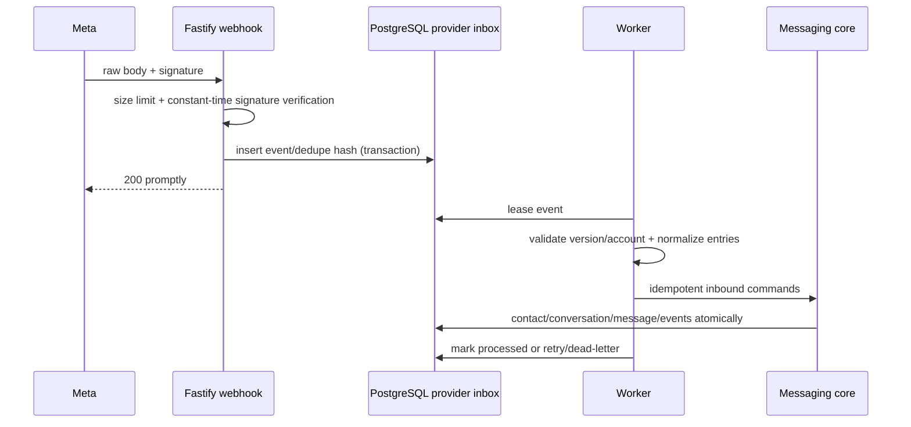

# Facebook Messenger and Instagram Integration Design

## Evidence date and caveat

Research was checked on 2026-10-21 against Meta's official public Postman workspaces, which link back to Meta developer documentation. Meta eligibility, permission names, Graph versions, review requirements, reply windows and features change independently of Maevelle; Phase 06 and Phase 08 must repeat official-document verification before code/configuration changes.

Confirmed current signals:

- Messenger requires a Facebook Page, an app with `pages_messaging`, a Page access token requested by a person with the Page `MESSAGE` task, and generally a recipient who messaged within the standard 24-hour window or separately agreed to an allowed outside-window mechanism: [Meta Messenger Platform collection](https://www.postman.com/meta/messenger-platform-api/documentation/iyp204x/messenger-platform-api).
- Instagram messaging is for professional accounts; with Instagram Login it requires `instagram_business_manage_messages`, the customer must initiate the conversation, group messaging is unsupported, stale Requests conversations may not be returned after 30 days, and shared-media webhook payloads may contain only a URL: [Meta Instagram API collection](https://www.postman.com/meta/instagram/documentation/6yqw8pt/instagram-api).
- Instagram Login does not require linking a Facebook Page, and the `instagram_business_*` scope names replaced deprecated older scope values: [Meta Instagram Login collection](https://www.postman.com/meta/instagram/folder/6raa77c/instagram-api-with-instagram-login).

These facts establish architectural constraints, not guaranteed production approval.

## Prerequisites and go/no-go gates

Before Facebook Phase 06:

- Maevelle-controlled Meta Business portfolio, verified business/domain if Meta requires it;
- production Meta app and separate test app;
- Page with appropriate administrator/message task access;
- privacy policy, data deletion instructions/callback and required business details;
- requested permissions/features with advanced access/App Review where required;
- HTTPS callback reachable by Meta, stable DNS, app secret and verify token;
- Page access token acquisition/renewal/revocation procedure;
- test users/Page and reviewer screencast/instructions;
- approved understanding of the current response window and allowed message tags/use cases.

Before Instagram Phase 08:

- Instagram professional account (Business or Creator as current API permits);
- choose and document Instagram Login vs Facebook Login integration path; prefer Instagram Login unless required capabilities prove otherwise;
- `instagram_business_basic` and `instagram_business_manage_messages` (plus only genuinely required scopes);
- account/app tester roles and production advanced access/review;
- subscribed messaging webhook fields confirmed in the live current official docs;
- test account able to initiate DMs and represent Request/Primary/General behaviors.

Any failed prerequisite leaves the connection `DRAFT`/`DISCONNECTED`; it does not block website chat or the unified inbox.

## Adapter design

`MetaGraphClient` is a small typed `fetch` wrapper with explicit API version, timeouts, response validation, request IDs, rate-limit headers and safe error translation. Facebook and Instagram adapters share signature/token/error infrastructure but own distinct normalization and capability rules.

Do not install a broad third-party Meta SDK unless Phase 06 research demonstrates active maintenance, current Graph coverage, TypeScript quality and less risk than the narrow client. Official APIs are HTTP and current repository needs a small endpoint subset.

Connection configuration stores:

- channel kind, provider account ID/name, integration account/credential reference;
- selected Graph API version and granted scopes;
- subscribed fields/capability snapshot;
- token issued/expiry/last-debugged timestamps (not plaintext token);
- webhook subscription/health status and last safe error code;
- current reply-window calculation inputs.

## Webhook processing

GET verification matches `hub.verify_token` from encrypted/configured secret and returns only `hub.challenge`. POST computes HMAC-SHA256 over raw bytes using the app secret and compares constant-time. If Meta's current official scheme differs at implementation time, the current docs win.

Deduplication preference: explicit provider event/message ID; otherwise canonical hash of connection + object/entry time + message/mid + event type + stable payload subset. An event can contain several messaging events; each normalized event also owns a unique external reference.

Webhook acknowledgement is decoupled from domain processing. Unknown fields are ignored safely; unknown event types are recorded as `IGNORED`; malformed required shapes retry only if the failure could be transient, otherwise dead-letter with diagnostics.

## Outbound delivery and reply eligibility

Before accepting a staff reply, the adapter-derived capabilities check current connection status, recipient initiation, window expiry, content/attachment support and required message type/tag. UI presentation is advisory; backend rejects unsupported actions.

Provider calls include the stable Maevelle message/reference in local intent state. On success store provider recipient/message IDs. Echo webhooks reconcile the canonical outbound message instead of creating a second message.

Rate-limit errors use provider `Retry-After`/usage headers when available and introduce per-connection backpressure. Permission/token errors degrade the connection and pause further sends. A single Meta outage never blocks website-channel worker processing; separate bounded concurrency per adapter/connection prevents starvation.

## Capability baseline (must be runtime-confirmed)

| Capability | Website | Facebook | Instagram |
|---|---|---|---|
| customer-initiated text | yes | yes | yes |
| staff text | unlimited by provider | subject to window/policy | initiated recipient + provider policy |
| attachments | Maevelle allowlist | provider-supported set | provider-supported set and ownership limits |
| typing/seen | optional native | supported where documented | capability check |
| reactions/edit/delete | future native | runtime capability | runtime capability |
| group thread | no | not in current Maevelle scope | unsupported by cited API |
| history import | Maevelle history | limited to official API access | Requests older than stated limit may be unavailable |

The core must show `Unknown/unsupported` honestly and never synthesize delivery/read state.

## Token and connection lifecycle

1. Authorized owner/connection manager starts OAuth; state is single-use and organization-bound.
2. Callback exchanges token server-side, validates granted scopes/account ownership, encrypts token in existing integration credential storage and creates/updates connection.
3. Subscribe webhook fields and perform a bounded diagnostic.
4. Worker periodically checks health/token metadata without logging token.
5. Expiry/revocation marks `DEGRADED`/`DISCONNECTED`, pauses intents, emits operational notification.
6. Reconnect creates a new credential revision and revalidates provider account identity; never silently attaches a different Page/account to existing history.
7. Disconnect attempts official unsubscribe/revoke, destroys local credential material, retains canonical transcript/audit and prevents new sends.

## Testing and approval readiness

- Contract fixtures for every subscribed event and error class, derived from official examples and captured redacted sandbox payloads.
- Signature tests use exact raw bytes, wrong secret, altered body and duplicate delivery.
- Sandbox/manual flow: customer initiates; inbound normalization; agent reply; echo/delivery; attachment; outside-window rejection; token revocation; reconnection.
- Verify development-mode/tester limitations separately from production behavior.
- Record actual approved scopes, Graph version, account IDs, reviewer decision and observed rate headers in connection runbook—not this timeless core architecture.

## Known blockers/uncertainties

- App Review/advanced access/business verification approval is external and cannot be guaranteed.
- Current Page/account eligibility, supported webhook fields, reply tags/windows and API version lifetime must be rechecked in each implementation phase.
- Meta may not expose full historical conversations, all inbox folders, every attachment, edit/delete/reaction behavior, or reliable read receipts.
- Production integration must not launch until the owner has working Meta assets, approved permissions and policy/legal review.
