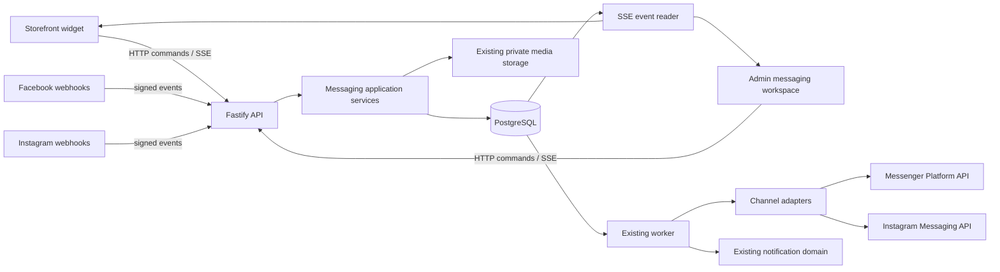

# Omnichannel Messaging Architecture

**Status:** Phase 05 Admin Messaging Workspace complete
**Date:** 2026-10-22
**Scope:** Storefront live chat, unified Admin inbox, Facebook Messenger, and Instagram Direct
**Authority:** Current source and migrations outrank historical design documents. This design does not authorize a production migration or provider connection.

## Decision summary

Maevelle will implement messaging as a domain module in the existing modular monolith. PostgreSQL remains the transactional authority. The API accepts commands and serves queries; server-sent events (SSE) deliver replayable persisted changes; the existing worker leases durable jobs and delivers outbound provider messages. Storefront, Facebook, and Instagram are capability-aware channel adapters around one conversation/message model.

The design deliberately does **not** introduce Redis, a broker, a messaging microservice, a Meta SDK, or a second customer database. AI, WhatsApp, email ticketing, and voice/video are outside Phases 01–09.

## Reading order

1. [Codebase audit](00-codebase-audit.md)
2. [Requirements and system architecture](01-system-architecture.md)
3. [Database design](02-database-design.md)
4. [API and event contracts](03-api-and-event-contracts.md)
5. [Realtime, reliability, identity, and security](04-realtime-reliability-security.md)
6. [Storefront and Admin UX](05-storefront-admin-ux.md)
7. [Meta integration design](06-meta-integrations.md)
8. [Performance, operations, packages, and folders](07-operations-packages-folders.md)
9. [Architecture decisions](08-adrs.md)
10. [Phase roadmap and Phase 01 handoff](09-roadmap-and-phase-01-handoff.md)
11. [Phase 00 architecture review](10-architecture-review.md)
12. [Phase 01 implementation record and Phase 02 handoff](11-phase-01-completion.md)
13. [Phase 02 Storefront backend completion and operations](12-phase-02-completion.md)
14. [Phase 03 Storefront live chat frontend completion](13-phase-03-completion.md)
15. [Phase 04 Unified Inbox and messaging operations backend completion](14-phase-04-completion.md)
16. [Phase 05 Admin Messaging Workspace completion](15-phase-05-completion.md)

## Architecture at a glance

## Non-negotiable invariants

- Every business row is organization-scoped; cross-organization joins use organization-qualified FKs.
- An authenticated staff identity is not authorization. Every Admin operation is capability checked on the server.
- A channel identity is not automatically a Maevelle customer. Linking requires an authenticated account relationship, verified contact proof, or an audited staff decision.
- A message is persisted before external delivery. Delivery is at-least-once at transport boundaries and idempotent at Maevelle boundaries; exactly-once network delivery is not claimed.
- `conversation.sequence` defines canonical message order. Provider timestamps are evidence, not ordering authority.
- Provider capabilities and reply eligibility are evaluated before accepting an outbound operation.
- Message bodies and private attachment URLs are not written to ordinary logs, notifications, or analytics payloads.
- Storefront and Admin messaging UIs remain separate compositions over the same canonical contracts.

## Phase 06 readiness

Phases 01–04 are implemented. The shared core has a complete website channel,
and the Storefront now has the lazy, responsive customer chat interface over
its public commands, private media, and replayable SSE. The administrative
backend now provides a tenant-safe, capability-authorized operational inbox,
assignment, collaboration, customer context, follow-up, configuration,
notification and reporting APIs. See the
[Phase 02 backend operations record](12-phase-02-completion.md) and
[Phase 03 frontend completion record](13-phase-03-completion.md), and the
[Phase 04 backend completion record](14-phase-04-completion.md).

Phase 05 adds the complete responsive Admin Messaging Workspace over the same
canonical contracts. Staff can operate the website inbox, reply with text and
private images, collaborate, link verified customer context, manage follow-ups,
configure operations and inspect bounded reports without a second messaging
store. Phase 06 can add the Facebook adapter by creating a channel connection
and provider ingress/delivery adapter; the Admin workspace remains channel
neutral and requires no parallel inbox.
