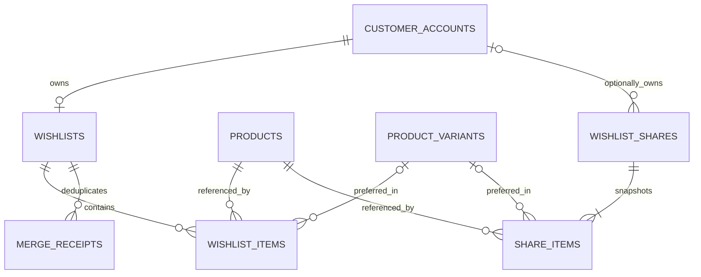

# Wishlist Phase 00 — repository audit and architecture

Status: **Phase 00 complete as a design; Wishlist implementation incomplete.** Evidence is the working tree on 2026-10-30, branch `main` (one commit ahead of `origin/main`), including uncommitted Wishlist source and migration. This report specifies the target; it does not assert that uncommitted code was deployed or that staging has its schema. No runtime, database, browser, or deployment check was run for this audit. Source paths and line numbers below refer to this working tree and may move.

## A. Executive summary

Maevelle has a usable partial browser-owned guest Wishlist and an in-progress guest snapshot share path. It lacks customer-controlled storefront authentication, an account-owned private Wishlist, reliable guest merge, shared contracts, aggregate Wishlist reporting, and complete share lifecycle controls. Existing guest state stores product presentation data and has cross-tab lost-update exposure. The uncommitted sharing migration and routes are **implementation evidence, not an approved final design**; they need review and compatible forward-only correction before any staging deployment.

The target is one private default list per verified storefront account, product ID as the unique entry, optional preferred variant, `localStorage` guest references, server-owned account state, explicit desired-state commands, and revocable fixed-membership share snapshots. Public details always come from current published catalog data. View and management capabilities are independent. Wishlist neither reads nor writes Cart or Checkout state. Recipient saving invokes the recipient's own Wishlist command.

Phase 01 can begin with contracts, account-identity boundary design and a forward migration plan. Account endpoints cannot be made available until a real customer-controlled session and organization-scoped ownership mapping exist. Guest work and share hardening can proceed independently; full account behavior remains a dependency. The current tree must be reconciled before adding migrations because `3208_wishlist_sharing.ts` is already untracked and registered.

## B. Verified repository findings

| Area | Evidence | Finding |
|---|---|---|
| Workspace | `package.json:1-15`, `pnpm-workspace.yaml:1-3` | pnpm 11.19, Node 24, TypeScript monorepo; apps and packages. Storefront Next 16.4.2/React 19.2.8, API Fastify 5.12.7/Better Auth 1.7.12, database Kysely 0.29.5 (`apps/storefront/package.json:13-20`, `apps/api/package.json:16-19`, `packages/database/package.json:210`). |
| Existing scope | `apps/storefront/app/cart/page.tsx`, `apps/storefront/app/checkout/page.tsx`, `apps/api/src/routes/auth.ts:23-25` | Cart and Checkout **do exist**, contrary to request background. They remain untouched and out of this project. |
| Catalog identity | `packages/database/src/migrations/0200_catalog.ts:151-193,298-342` | Organization-scoped product UUID; mutable unique handle; active/published lifecycle. Variants belong to product and may be archived. Handle history exists at lines 195-201. |
| Public catalog | `packages/database/src/storefront.ts:106-113,217,345`, `apps/api/src/routes/catalog.ts:1336-1390`, `apps/storefront/lib/api/server/catalog.ts:73-79` | Storefront filters active/published products; PDP uses handle with redirect path and variant pricing. Public product DTO is `packages/contracts/src/index.ts:922`. |
| Images, price, stock | `packages/database/src/migrations/0200_catalog.ts:298-342`, `packages/database/src/storefront.ts:106-113`, `apps/api/src/routes/wishlist.ts:24-45` | Pricing and availability are derived from current catalog/search projection. Public media is filtered by asset visibility. Wishlist must not own those values. Search projection freshness remains a runtime verification item. |
| Guest state | `apps/storefront/features/wishlist/wishlist-store.ts:4-91`, `types.ts:3-19`, `use-wishlist.ts:7-64` | `localStorage` with `useSyncExternalStore`, storage event, 100-item cap. It persists full card data including price, title, handle and stock; each tab writes whole array. No account adapter or variant preference. |
| Storefront UI | `apps/storefront/components/commerce/product-card.tsx:163-177,249-256`, `components/product-page-client.tsx:45-46,88-113`, `features/wishlist/components/wishlist-page-shell.tsx:28-102`, `components/layout/desktop-navbar.tsx:146-153,400-408`, `components/layout/bottom-nav.tsx:8` | Hearts, PDP control, header count and guest page exist. PDP currently saves product, not selected variant. Wishlist page hydrates via one bounded public request; unavailable rows can be shown. Legacy mobile/desktop Wishlist view files still exist and should be checked before reuse. |
| Partial sharing | `apps/api/src/routes/wishlist.ts:48-84`, `packages/database/src/wishlist-sharing.ts:14-73`, `packages/database/src/migrations/3208_wishlist_sharing.ts:4-31`, `apps/storefront/features/wishlist/components/wishlist-sharing-panel.tsx:7-94`, `shared-wishlist.tsx:13-75` | Guest snapshot creation/open/manage, independent random 32-byte tokens, SHA-256 digests, 30-day expiry, client fragment URL, revocation, renew, recipient save exist in dirty work. No account share owner, claim, server pagination, cleanup, robust distributed rate limit, or shared contract. |
| Authentication | `apps/api/src/auth/auth.ts:24-42,84-100`, `apps/api/src/routes/auth.ts:130-160,190-207`, `packages/database/src/migrations/0004_iam_and_authentication.ts:12-47` | Better Auth establishes IAM identity; Admin capability and active membership are separate. Current routes use Admin context. No verified storefront sign-in/out, customer session or account page. |
| CRM identity | `packages/database/src/migrations/0700_customers.ts:7-36,137-155`, `packages/database/src/customers/accounts.ts:19-126,323-459` | Commercial customer and IAM identity are separate; an account-link structure exists. Contact matching or an Admin session is insufficient to authorize a customer's private list. Existing resolver can create/link CRM customer; its use in a shopper session needs a customer-controlled proof boundary. |
| API contracts | `packages/contracts/src/index.ts:6,922,2495`, `apps/storefront/lib/api/client/http.ts:16-42`, `apps/api/src/app.ts:159` | `{data}` and structured errors are established; pagination DTO exists. No Wishlist contracts in shared package. API uses TypeBox at route boundaries. |
| Analytics | `packages/database/src/analytics/behavioral.ts:1-15,127-146,210-220`, `apps/storefront/lib/analytics/events.ts:44-65`, `apps/api/src/routes/analytics.ts:165-180,241-289`, `apps/worker/src/worker.ts:253` | Consent-aware behavioral ingestion, unique event ID, Admin `analytics.view` and Worker outbox processing exist. Wishlist event names and reporting are absent. |
| Migration/deployment | `packages/database/src/migrations/index.ts:59,122`, `packages/database/migration-history-baseline.json`, `docs/architecture/development-deployment-strategy.md`, `package.json:17-27` | SQL-first Kysely migration registry and migration-history guard. Existing staging is persistent; migration runs as controlled job, not service startup. Whether untracked 3208 is applied anywhere was **not verified**. |
| Tests | `packages/database/src/wishlist-sharing.test.ts:27-...`, `apps/storefront/lib/analytics/analytics.test.ts`, `apps/api/src/app.test.ts` | A guest-share database test exists in dirty work. No account Wishlist, merge, browser synchronization, access-control, or complete sharing tests were found in the inspected paths. No tests run in Phase 00. |

Current completion evidence is `docs/product-completion/state.json:1-22` and `current-focus.md:1-3`: active Wishlist, guest core in progress; neither document declares the complete capability. The older `areas/storefront-wishlist/audit-and-architecture.md` is a concise direction note and is superseded in detail by this report. Git has unrelated untracked `stockout-interest/` notes; preserve them.

### Reuse matrix

| Reuse now | Extend | Build |
|---|---|---|
| Public catalog and media projection; product card/PDP/header components; API envelope and client HTTP helper; TypeBox validation; Kysely transactions; Worker/outbox; Admin analytics permission | Guest store to reference-only records and conflict-aware writes; public catalog batch hydration; analytics event allowlist/reports; Wishlist UI and sharing controls; CRM identity/deletion integration | Customer-controlled storefront session; account Wishlist tables/service/routes; merge protocol; account share ownership/claim; share lifecycle/cleanup; focused security and end-to-end tests |

### Confirmed gaps and limits

**Blocking:** customer-controlled session and organization-scoped account ownership; authoritative account list/merge; staging migration status before altering 3208. **Incomplete:** guest share abuse controls, account shares, claim, cleanup, UI states, metadata, shared contracts and analytics. **Optional:** Redis, search service, separate queue, multiple private lists. No live DB state, deployment status, production traffic, accessibility audit, or benchmark was inspected. Those are verification gates, not claims of absence.

## C. Catalog rules and Wishlist identity

Choose **one entry per `(organization, owner, product)`**, with nullable `preferred_variant_id`. Product-only loses useful PDP intent; variant-only duplicates the same product and makes cards inconsistent. The variant must belong to the product and be active at write time; if later archived/deleted, keep the product saved, clear or mark the preference unavailable, and offer current options. A composite FK `(organization_id, product_id, preferred_variant_id)` can enforce membership when non-null using the catalog's composite unique key; active status is an application invariant checked in the same transaction. Share membership freezes product IDs and optionally the selected variant preference as a hint; it never freezes price, image, handle, stock or private metadata.

On price/image/handle change, resolve current published catalog data on read, so a changed handle becomes the new link. Out of stock stays saved with clear availability; no reservation is implied. Unpublished/archived products remain as private unavailable references for owner removal and are omitted from public share hydration. Permanent deletion needs an explicit policy: prefer catalog soft archive; if hard delete is permitted, cascade Wishlist item/share-item references and show a reduced count or a generic removed placeholder without exposing private data. A share with zero currently public products remains an available, empty collection until expiry/revocation; do not treat it as a token miss.

## D. Domain and ownership architecture

`packages/database/src/wishlist/` should own repository SQL, commands/queries, share capability, cleanup and invariant tests; `apps/api/src/routes/wishlist/` should only validate/map transport, resolve session and errors; `packages/contracts/src/wishlist.ts` should own shared DTOs and schemas where practical; `apps/storefront/features/wishlist/` should own adapters/controller and UI. Catalog remains authoritative for product eligibility, current price/availability/media. IAM verifies a shopper session; customer-account mapping supplies organization-scoped ownership; CRM is not an implicit authorization source. Analytics consumes successful domain outcomes through bounded events/outbox and never drives the command. Admin gets aggregate metrics and audited abuse takedown only, not normal private-list browsing.

One default private list per account is sufficient. A share is an independent collection; multiple private lists are not required. Future Recommendations may consume consented aggregate signals or an authorized saved-state query. Future Cart/Checkout may consume selected product/variant IDs through stable Wishlist contracts and must revalidate catalog/inventory/pricing in their own domain. Wishlist will not manipulate those modules.

## E. Guest, account, synchronization and merge

Use `localStorage` for guest **reference-only** records `{productId, preferredVariantId?, savedAt, localRevision, mutationId}` with a schema version and small bounded size. It is already used and supported by the storefront (`wishlist-store.ts:4-31`). IndexedDB would add async migration/transaction complexity without current size pressure. `localStorage` is synchronous and writes are atomic per key, but read-modify-write across tabs is not transactional. Use `storage` event plus `BroadcastChannel` notification when available, and reconcile from storage before each write. To prevent simultaneous-tab lost updates robustly, use an append-only bounded operation journal keyed by random operation ID per tab, or `navigator.locks` when available with journal fallback; compact deterministically. A last-write-wins full-array overwrite is insufficient. If storage is denied/quota-exhausted, keep a clearly labeled memory-only session with retry/export option; do not claim persistence or create an unmanageable guest share. No guest PII is needed.

Account source of truth is PostgreSQL. A storefront account session must prove user control, resolve an active organization-specific customer account, and never infer ownership from CRM email/phone match alone. On login, load server list and merge guest journal. On logout/account switch, invalidate request generation, abort pending mutations, clear cached private account data and optimistic overlays, retain only explicitly guest-owned unsynced operations, then re-read under the new principal. Multi-device sync revalidates on focus/reconnect and after mutations; cross-tab messages signal re-fetch, not transfer private data. Use `useSyncExternalStore` or a narrow context around one controller, not another state dependency. Batch saved IDs for product grids; never issue one request per card.

Mutations are **desired-state** `PUT` save and `DELETE` remove, serialized per product in the client with a monotonically increasing local intent counter. Show immediate pending UI; keep only the latest intent, reconcile server response to its matching generation, and re-fetch on unknown outcome. The server uses unique `(wishlist_id, product_id)` and serializes conflicting commands per product. A stale network response cannot overwrite later intention. Offline account edits queue in memory only unless a durable, principal-bound operation journal is deliberately added; tell the shopper that saving will retry, and never silently claim sync.

### Merge protocol

Client freezes a guest journal revision and sends an operation batch with a stable `mergeId` UUID and digest. Server authenticates the target **shopper** account, claims `(organization, owner, mergeId)` atomically, validates product/variant eligibility, then upserts missing products without replacing existing account items. Existing account variant preference wins on duplicate unless it is null and incoming preference is valid. Record per-item accepted/skipped results and server version in a durable receipt in the same transaction. A repeated `mergeId` and same payload returns the receipt; different payload returns 409. Overlapping new account actions are ordered by server transaction/version; merge never resurrects a product explicitly removed after the merge began: perform merge against a captured account version, reject/rebase on version conflict, and/or retain short-lived per-product deletion tombstones through the merge retry window. The client deletes **only accepted** frozen guest operations after receipt persistence, leaving rejected or newer guest operations for review/retry. If response is lost, retry same `mergeId`; if sign-out occurs, stop and never send to a different account. Example `{A,B,C}+{B,D,E}` yields `{A,B,C,D,E}` with B's account preference preserved. Merge uses a bounded batch and cursor/chunk receipts for larger lists, not a half-applied sequence.

## F. Sharing architecture

Each share is a fixed ordered snapshot of selected saved product IDs (and optional preferred variant hints). Creating another link makes an independent snapshot. The share's public hydration uses current catalog fields. Owner removal does not change existing share membership; explicit share item update should be a separate authenticated/re-authorized command or, simpler, create a new link and revoke the old one. This project can use the latter, which avoids ambiguous link mutation.

Guest create validates a bounded selection of **currently public** products and stores a server snapshot. Client receives two 256-bit random base64url tokens once: public view and private manage. Store only SHA-256 digests for guest shares in PostgreSQL with unique indexes; use indexed digest equality and constant-time comparison only if a separately stored secret comparison is introduced. The public view capability cannot list, renew or revoke. Guest management token stays in browser storage as a bearer secret; no URL, analytics, log, error or referrer may include it. If storage fails after creation, attempt immediate revoke and warn; a lost credential cannot be recovered by support from the public link alone. Abuse operators can revoke with a separate capability/audit. To claim after sign-in, require a valid manage token **and** verified customer session; also require the matching view token so the account can later recover/copy the link. Verify both digests identify the same share, transfer ownership atomically, encrypt the view token, rotate/invalidate the guest management token, and return account-managed share metadata. Do not claim based on a view link, local data, CRM match or shared device alone.

Account shares use `(organization_id, owner_customer_account_id)` and normal account authorization for create/list/detail/revoke/extend. Account deletion/anonymization revokes and cleans shares according to privacy policy. Recommended default expiry 30 days, user selectable 1–90 days, renew only by owner; revocation immediate and irreversible. Renewal is desired-state `PATCH expiresAt` (bounded from now) rather than “add 30 days” because retries of the current `renew` command (`wishlist-sharing.ts:65-69`) extend repeatedly. Expired links remain revocable/listable for a short management window; no public resurrection after cleanup. Retain revoked/expired metadata for 30 days for audit/abuse diagnostics, then purge snapshot rows and token digests; aggregate analytics may outlive with no token or customer ID. Worker handles scheduled cleanup, with ordinary reads always enforcing expiry/revocation.

Public route should be `/wishlist/shared/[viewToken]` for server verification and safe metadata **only if** logs, referrers, CDN and analytics are guaranteed to redact the token; otherwise retain the current fragment route `/wishlist/shared#token`, which avoids server/log exposure but forces client hydration and generic social preview. Given the current architecture and privacy priority, **choose fragment route now** and generic static Open Graph metadata. The current `shared/page.tsx` and `shared-wishlist.tsx:19-31` support that model. Page response and API use `Cache-Control: private, no-store`, `Referrer-Policy: no-referrer`, `X-Robots-Tag: noindex, nofollow, noarchive`; `robots.ts`/sitemap must omit it. No customer name, message, contact, list title or private metadata in response or preview. A link can be forwarded; UI says anyone with the link can see the snapshot. Display public items with current prices/availability, unavailable count/placeholders without leaking private product details, and separate Save/Save All to recipient's own guest/account list. Save All filters eligible current public items, is bounded, dedupes and reports partial results. Link-preview crawlers do not trigger “open” analytics from generic GET; client signals qualified human view after interaction/dwell and consent, still not a verified unique person.

Current uncommitted implementation has material gaps: `wishlist-sharing.ts:44-52` returns product IDs without catalog visibility filtering; client then filters, creating inconsistent counts. Its share join lacks an explicit organization predicate on item join (the composite FK currently constrains data, but tenant-scoped queries should still be explicit). In-memory IP limiting at `wishlist.ts:8,51-60` is process-local and can be evaded across instances/restarts; use the existing gateway/database-backed bounded abuse mechanism if available, otherwise add a small PostgreSQL counter, not Redis by default. `manage` has no rate limit, and revocation/read races require a clear linearization: read checks state in the same database statement/transaction, while responses already in flight before revocation cannot be recalled. Guest share client stores both tokens in localStorage (`wishlist-sharing-panel.tsx:7-13`): XSS can steal them, so CSP/escaping and short lifetimes matter. No specific product relation to the guest's browser-owned list can be authenticated server-side; UI selects from that list and server validates public eligibility only. This limit is inherent without a guest server session and should be disclosed.

## G. Proposed PostgreSQL schema and migration plan

All tables live in `wishlist`, use `organization_id`, UUIDv7 keys where consistent with existing migrations, `timestamptz` and composite tenant FKs. SQL below is **design only**, not executable migration. Do not edit an applied 3208 migration. Determine staging migration status first; if applied, add additive `3209...` and subsequent migrations. If not applied, still preserve the dirty file until its origin is understood; review/reconcile it before its first deploy. Backfill no account data (none exists). Deploy schema before API/Worker/Storefront consumers, run migration once, preserve the previous schema-compatible release and a forward-repair/verified restore path.

| Table | Columns and constraints | Indexes, deletion, retention |
|---|---|---|
| `wishlists` | `id uuid PK`, `organization_id uuid NOT NULL`, `owner_customer_account_id uuid NOT NULL`, `version bigint NOT NULL DEFAULT 1 CHECK >0`, `created_at`, `updated_at`; unique `(organization_id, owner_customer_account_id)`; composite FK to `customers.customer_accounts(organization_id,id)` needs a matching unique constraint on account table (add it forward-only), plus active-link check in service. | Owner unique covers lookup. On account deletion/anonymization, explicit privacy service purges list; avoid blind CRM merge reassignment. |
| `items` | `id uuid PK`, `organization_id`, `wishlist_id`, `product_id`, `preferred_variant_id uuid NULL`, `saved_at`, `updated_at`, `version bigint`; unique `(organization_id,wishlist_id,product_id)`; FK `(organization_id,wishlist_id)` to list, `(organization_id,product_id)` to product, optional composite `(organization_id,product_id,preferred_variant_id)` to variant; version positive. | `(organization_id,wishlist_id,saved_at DESC,id DESC)` for keyset, product count index if aggregate needs it. Delete with list; catalog hard delete policy must be explicit (`ON DELETE CASCADE` or controlled purge). No stored price/media. |
| `merge_receipts` | `(organization_id,wishlist_id,merge_id)` PK, `request_digest bytea`, `account_version bigint`, bounded result JSONB, `created_at`, `expires_at`; CHECK expiry and result shape. | Expiry index; retain beyond client retry window (proposed 30 days), purge in Worker. Conflict on same key/different digest. Tombstones or version conflict protection must cover this window. |
| `shares` | Existing 3208 fields: `id`, `organization_id`, `view_token_digest`, `manage_token_digest`, timestamps. Make `manage_token_digest` nullable for account shares; add nullable `owner_customer_account_id`, `creator_kind` CHECK guest/account, `view_token_ciphertext`/`view_token_key_id` nullable for account link recovery, `updated_at`, `version`, `item_count`, `revoked_at`, `expires_at`, optional abuse `revocation_reason_code`; ownership CHECK: account has owner and no guest manage digest, guest has manage digest and no account owner/ciphertext; unique digest indexes; composite account FK. Claim rotates/discards guest manage digest and encrypts the view token supplied by guest at claim time after verifying its digest. | `(organization_id,owner_customer_account_id,created_at DESC,id DESC)` partial account index; expiry cleanup index already exists. No plaintext tokens or private customer fields. Retain 30 days after end, then delete. Encryption key stays outside Git with rotation procedure. |
| `share_items` | Existing 3208: `(organization_id,share_id,product_id,position)` with PK share/product, unique share/position, FKs to share/product. Add nullable `preferred_variant_id` with composite variant FK if share preference is surfaced. Position 1–100. | Ordered share read uses unique share/position. Cascade with share and controlled catalog hard deletion. |
| Optional `mutation_tombstones` | `(organization_id,wishlist_id,product_id)` PK, `removed_at`, `version`, `expires_at`; records explicit removals only for merge protection. | Expiry index; 30-day retention. Prefer using list version/rebase if it fully prevents stale merge resurrection, to avoid this table. |

Avoid storing every guest Wishlist on the server. Share snapshot is the only server-side guest collection. Check share size 1–100 and active guest share creation budget; account list may grow beyond 100, so keyset pagination is mandatory. Current guest store cap is 100, which should be reviewed against product requirements rather than silently imposed on accounts.

Create/merge/share/claim/revoke transactions own all related row changes plus audit/outbox event. Use unique constraints as concurrency authority, not check-then-insert. Share create should insert items with a set operation rather than the current per-item loop (`wishlist-sharing.ts:35-38`). Do not hold a transaction across external analytics delivery.

## H. API and contract specification

Prefix `/storefront/v1`. Use `TypeBox` at API boundary, shared `Wishlist*Dto`/request DTOs in `packages/contracts/src/wishlist.ts`, `{data}` success and `{error:{code,message,details?}}` errors. Public IDs are UUIDs; no database row, owner ID, manage digest/token, private account data or audit fields appear in public DTOs. Authentication means a **customer storefront session** and resolved active account; Admin sessions never substitute. All account paths derive owner from session, never from a client `customerId`. Default page size 24, max 100, signed/validated opaque keyset cursor with deterministic `(saved_at,id)` ordering. Sort `recent`, `oldest`, `title` (title sort may require catalog join; stable tie-break ID); no arbitrary SQL sort. Rate values below are proposed and should be tuned after traffic evidence.

| Operation | Method/path | Auth and input | Output, semantics, failures, controls |
|---|---|---|---|
| Account list | `GET /wishlist?cursor=&limit=&sort=` | Shopper account | `WishlistPageDto {items, pageInfo, count, version}`. Private `no-store`; 401 unauth, 403 inactive mapping, 400 cursor/sort. Current public catalog hydration plus unavailable marker. |
| Saved identities | `POST /wishlist/saved-state` | Shopper; `{productIds: uuid[1..100]}` | `{savedProductIds, version}`; batch only, no card N+1; rate 60/min/session. Guest uses local state. |
| Save / preference | `PUT /wishlist/items/:productId` | Shopper; `{preferredVariantId?:uuid|null, expectedVersion?:number}` | Item + list version; idempotent desired state, validate public product and active variant relation; 404/422/409. Existing account preference unchanged when omitted; explicit null clears. Rate 120/min. |
| Remove | `DELETE /wishlist/items/:productId` | Shopper | 204 even absent, records explicit delete ordering/tombstone; rate 120/min. |
| Merge | `POST /wishlist/merges` | Shopper; `Idempotency-Key` = mergeId; `{baseVersion, items:[{productId,preferredVariantId?,savedAt?}]}` max 100/chunk | Receipt `{accepted,alreadyPresent,invalid,version}`; same key/body replay, changed body 409; version conflict 409; 401/403; rate 10/hour. Never overwrite account items. |
| Guest product hydration | Existing `POST /wishlist/products` | Public; UUID[0..100] | Public catalog projection only, current price/media/availability, 200 with missing IDs omitted; rate 60/min/IP and body size bound. Existing route at `wishlist.ts:17-46`. |
| Guest create share | Existing `POST /wishlist/shares` | Guest; `{productIds:uuid[1..100],expiresAt?}` | 201 `{shareId,viewToken,manageToken,expiresAt,itemCount}` once, no-store. Validate public products; no proof of browser save list. Current route needs stronger rate/abuse protection. |
| Account create share | `POST /wishlist/account-shares` | Shopper; `{productIds,expiresAt}` | 201 `{id,viewUrl,expiresAt,itemCount}`; require items belong to owner at transaction snapshot, public eligibility; account auth; stable idempotency key for retries; max active links proposed 50. |
| Account list/detail | `GET /wishlist/account-shares[/:id]` | Shopper | Page/metadata with counts and current status; owner filter, 404 for other owner's ID. Cursor, max 100. Authorized detail can return `viewUrl` decrypted from envelope-encrypted view token so owners can copy existing links across devices; never return ciphertext, digest or management credential. Private no-store and audit access to token-bearing detail. |
| Account revoke/expiry | `DELETE /wishlist/account-shares/:id`; `PATCH .../:id` | Shopper; PATCH `{expiresAt}` | DELETE 204 repeat-safe, PATCH status/version; 404 other owner, 409 revoked, 422 expiry window. Audit. |
| Public open | Existing `POST /wishlist/shares/open` | Public; `{token}` | Public items resolved in one server query, expiry, unavailable count, no private IDs; generic 404 for invalid/expired/revoked; no-store/no-referrer, rate 120/min/IP. Existing endpoint currently exposes raw product IDs, to replace. |
| Guest manage | `POST /wishlist/shares/manage` | Guest bearer manage token; `{token,action:'inspect'|'revoke'}` or `PATCH` expiry | No public token accepted. Generic 404 for bad credential, rate 30/min/IP plus digest budget; revoke repeat-safe, expiry desired-state. `inspect` returns metadata only. |
| Claim | `POST /wishlist/shares/claims` | Shopper + both guest tokens; `{manageToken,viewToken}` | Both digests must identify same share; account ownership transferred, view token encrypted for later owner copy, guest manage token invalidated; 409 already claimed, 404 bad token, audit. Rate 10/hour. |

Contract error codes: `VALIDATION_FAILED`, `UNAUTHENTICATED`, `FORBIDDEN`, `NOT_FOUND`, `VERSION_CONFLICT`, `RATE_LIMITED`, `STORAGE_UNAVAILABLE`, `INTERNAL_ERROR`. Public share lookup returns indistinguishable 404 for invalid/expired/revoked and should have comparable response timing where feasible. `Idempotency-Key` must be stored with request fingerprint for share create/merge; an in-flight duplicate gets 409/Retry-After or bounded wait, never a second share. Account share listing must not leak raw bearer credentials. Existing guest manage action `renew` is not retry safe, so replace with explicit expiry.

## I. Storefront frontend and UX

Keep server-rendered catalog/PDP shell and narrow client Wishlist controls. Product cards use one reusable heart with 44px touch target, keyboard focus, pressed state and labels “Save [product]”/“Remove [product]”; duplicate cards share the same central state. PDP uses selected variant as optional preference and product-level heart state. Header and mobile nav show count from the same controller; during hydration show a stable neutral state to avoid false zero. Save never masquerades as stock reservation. Existing component and route locations are in section B.

`/wishlist` is a responsive grid with current catalog data, explicit unavailable rows, recent/title sorting, server paging for accounts, guest local order, remove + timed Undo (Undo is a new desired-state save, not silent reversal after account switch), empty/loading/error/partial sync states, and prominent Share action. Avoid the existing legacy “move to bag” stubs (`use-wishlist.ts:63-64`) in Wishlist flow; Cart remains out of this project. Use established Tailwind design tokens and shared controls; mobile share management uses a full-height sheet/dialog with reachable actions above keyboard. The creation action is on the Wishlist page. Choose all/selected items in one focused flow, give 30-day default expiry with visible date, then Copy Link/native `navigator.share`/messaging platform URLs. Messaging URLs must encode only the public URL and neutral text. Preserve guest credential loss warning. Account share list shows expiry/revoke/copy for existing links through an authorized no-store detail request; avoid loading decrypted link URLs for an entire list unnecessarily.

Recipient `/wishlist/shared#token` is mobile-first and read-only, with generic metadata, loading/expired/revoked/unavailable states, current public product cards, Save and Save All. Focus moves to feedback on errors or uses `aria-live`; buttons communicate pending/disabled. No “Add to Cart” or Checkout action is introduced by this feature. Accessibility and responsive checks must include touch, keyboard, screen reader labels, 320px–desktop, tablet orientation, and reduced motion.

## J. Analytics and operations

Add separate domain outcomes and consented browser observations. Domain outcomes: `wishlist.item.saved`, `wishlist.item.removed`, `wishlist.merge.completed/failed`, `wishlist.share.created/revoked/expired/claimed`, and recipient save attribution. Browser observations: `WISHLIST_VIEW`, `SHARE_VIEW_QUALIFIED`, `SHARED_PRODUCT_OPEN`, with existing consent policy and event ID dedupe. Add names to the existing contract/ingestion allowlist (`packages/contracts/src/index.ts:1100-1210`, `analytics/behavioral.ts:1-15,127-146`); do not silently send unsupported events. Domain events occur transactionally or via existing outbox, so a client analytics failure never fails a save. Every event includes organization, event ID, product ID where appropriate, guest/account class, share surrogate ID only, timestamp, origin and consent; **never raw tokens, URLs with fragments, customer contact or full private list**. Count current active saved products from authoritative items; count events separately and label them as actions, not purchases or unique shoppers. Guest counts are browser-level estimates and preview bot traffic is excluded/qualified. Aggregate most-saved products and share funnel in existing Admin Analytics under `analytics.view`; operational failures in logs/metrics with safe codes, no secrets. Set retention to existing analytics policy, with share event identifiers detached on deletion; verify actual policy before implementing new retention job. Track API latency/errors, merge conflicts, storage failures (client opt-in), share abuse rejects, cleanup lag and outbox backlog.

## K. Security, privacy, performance and scalability

Trust boundaries: browser guest state is user-controlled and untrusted; customer cookie proves authentication only; account mapping and organization filter authorize; view link is a forwardable bearer capability; manage token is a stronger independent bearer capability; public catalog query is the only source for recipient content. All SQL includes organization scope even when FKs constrain it. CSRF protections for cookie-authenticated mutations must use same-origin checks and existing Better Auth CSRF/trusted-origin behavior; verify actual cross-origin proxy path before enabling. Bearer guest management endpoints must reject permissive CORS, validate content type/size, and rate limit. XSS protection matters because localStorage contains manage tokens: use React escaping, CSP, no unsafe HTML, no token in third-party scripts/analytics. Constant-time HMAC/digest comparison applies if comparing secrets in app memory; indexed SHA-256 digest lookup does not use a timing-safe string comparison but 256-bit random tokens resist guessing. Avoid revealing whether a product was saved by another customer; resource IDs alone confer no access.

Public share no-store prevents cache serving after revocation. Revocation is enforced at every API open; a response already delivered cannot be retracted. Generic preview avoids fragment disclosure and private metadata. Search engines receive noindex plus exclusion from sitemap/robots. A forwarded link remains accessible until expiry/revocation. Guest management credential loss is unrecoverable by design unless later claimed. Account and CRM deletion must revoke/purge private items and shares; audit should record actor/action, not raw token or full snapshot. Abuse operators get a narrowly scoped capability and reason-coded action.

Query plan: unique digest index for share lookup; composite owner/list indexes; keyset page; batch product hydration; bounded 100-item share and saved-state requests; set-based inserts; no N+1 card fetch. Current public product hydration query (`wishlist.ts:24-45`) is bounded but may need deterministic order and projection freshness verification. Proposed targets, **not measured results**: p95 saved-state <150ms, list <250ms for 24 items, share open <250ms for 100 items at normal staging load; <1% non-validation API failures; revocation visible on next open. PostgreSQL and current Worker are adequate until measured capacity proves otherwise. Do not introduce Redis, new queue, search service or table partitioning on speculation. Load tests at acceptance should use representative products, lists, shares, concurrent mutations and cleanup volume, then tune indexes/rates.

## L. Failure and edge-case matrix

Phase numbers refer to the roadmap below. “Test” is the essential evidence to add in that phase.

| # | Scenario | Expected consistency and security | Test / phase |
|---|---|---|---|
| 1 | Guest save, refresh | Reference survives if storage persists; catalog rehydrates current details. | Browser reload / 02,04 |
| 2 | Guest multi-tab save | Union of distinct operations, no whole-array lost update. | Simultaneous tabs / 02 |
| 3 | Storage cleared | List gone; old guest manage token unrecoverable; public share remains until expiry. | Clear storage / 02,05 |
| 4 | Storage unavailable | Memory-only warning, no false persistence or unmanageable share. | Denied/quota storage / 02,05 |
| 5 | Signed-in multi-device save | DB authority and refetch converge. | Two sessions / 02 |
| 6 | Sign-out during save | Old response ignored, no next-account leakage; server command may finish for old owner. | Deferred request / 02 |
| 7 | Different account same browser | Private cache cleared; guest journal not auto-merged into wrong account. | Switch session / 02 |
| 8 | Merge retry | Same receipt, no duplicate/change; payload mismatch rejected. | Repeat key / 02 |
| 9 | Merge interrupted | Atomic transaction or resumable receipt; guest data retained until acknowledged. | Fault injection / 02 |
| 10 | Concurrent save/remove | Server serial order/version; final latest valid intent. | Racing commands / 01,02 |
| 11 | Rapid heart taps | Per-product client serialization; stale replies ignored. | Rapid click / 02,04 |
| 12 | Out of stock | Remains saved, current unavailable state; no reservation. | Catalog status / 01,04 |
| 13 | Unpublished | Private unavailable row; public share omits details. | Visibility transition / 01,03 |
| 14 | Product deleted | Controlled cascade/purge; generic missing row/count, no broken FK. | Hard delete / 01,03 |
| 15 | Variant changed | Preference validated, stale variant cleared/flagged; product remains. | Archive/delete variant / 01,04 |
| 16 | Same product in sections | One shared product-level state/count. | Duplicate cards / 04 |
| 17 | Guest creates share | Server snapshot fixed; separate credentials, expiry. | Create/open / 03,05 |
| 18 | Guest loses manage token | No recovery by view link; expiry/abuse takedown remains. | Clear token / 03,05 |
| 19 | Guest claims after sign-in | Requires manage token plus shopper session; rotate token. | Claim/old-token rejection / 03 |
| 20 | Link forwarded | Anyone holding public link can read only public snapshot. | Recipient session / 03,05 |
| 21 | Link expires | Generic unavailable, no catalog disclosure. | Clock boundary / 03 |
| 22 | Link revoked | Next open unavailable; cannot renew revoked link. | Revoke / 03 |
| 23 | Open after revoke | DB check blocks; no stale public cache. | Race/cache / 03,07 |
| 24 | Owner removes after snapshot | Share membership fixed; public eligibility still current. | Remove/open / 03 |
| 25 | Recipient saves one | Only recipient list changes; owner untouched. | Two principals / 03,05 |
| 26 | Recipient saves all | Eligible subset, deduped, bounded, partial report. | Mixed eligibility / 03,05 |
| 27 | Shared item unpublished | No product details leak; generic unavailable count. | Visibility flip / 03 |
| 28 | Preview bot visits | Generic preview; no qualified human-open count. | Crawler UA/metadata / 05,06 |
| 29 | Sharing unavailable | Guest/account list still works; retry safe, no fake link. | API 5xx / 05 |
| 30 | Wishlist backend unavailable | Guest memory/local works; account pending/error reconciles later. | Network failure / 02,04 |
| 31 | Large account list | Keyset pages stable; count from server, no huge payload. | 1k items / 01,04 |
| 32 | Concurrent revoke/read | Read linearizes before/after revoke; post-revoke reads fail. | Transaction race / 03 |
| 33 | Account deleted/anonymized | Private list purged, shares revoked/purged, aggregates deidentified. | Privacy lifecycle / 03,06 |

## M. Architecture decisions

All decisions below are **target decisions**, subject to migration/status and runtime verification stated. Alternatives and costs are explicit so Phase 01 can implement without rediscovering product direction.

| # | Decision and repository fit | Alternative; advantage / tradeoff / risk; status |
|---|---|---|
| 1 | Product UUID is unique entry (`0200_catalog.ts:151`). | Variant identity duplicates products; product UUID survives handle changes. **Final**. |
| 2 | Nullable preferred variant, validated relation (`0200_catalog.ts:298`). | No preference loses PDP intent; variant-only fragments state. Stale preferences need recovery. **Final**. |
| 3 | Guest `localStorage` reference journal (`wishlist-store.ts:4`). | IndexedDB adds complexity; localStorage has sync quota and cross-tab races addressed by journal. **Final**, retention/browser tests pending. |
| 4 | Verified shopper account + organization owns list; CRM link is mapping, not proof (`0700_customers.ts:137`). | Admin IAM or contact match leaks data. **Blocked on storefront auth**. |
| 5 | One default private list; shares are separate collections. | Multiple lists add UI/schema complexity without stated need. **Final**. |
| 6 | Merge union with durable idempotent receipt and version/tombstone protection. | Replace drops account items; naive upsert can resurrect removals. **Final protocol; tombstone choice verify in Phase 01**. |
| 7 | Narrow external store/controller with guest/account adapters (`use-wishlist.ts:7`). | New state library adds dependency; current pattern already exists. **Final**. |
| 8 | Storage/BroadcastChannel plus journal; account tabs refetch. | Full-array overwrite loses updates. **Final**, browser test required. |
| 9 | Desired-state optimistic commands, per-item serialization/generation. | Toggle is non-idempotent; delayed replies race. **Final**. |
| 10 | REST `{data}`/structured errors, batch IDs, keyset pages (`contracts/index.ts:6,2495`). | Card-by-card GET is N+1. **Final**. |
| 11 | Fixed membership snapshot with live public catalog details. | Live sharing can unintentionally expose later saves; frozen price becomes false. **Final**. |
| 12 | Independent 256-bit view/manage tokens, indexed digests for lookup; account view token additionally envelope-encrypted for owner link recovery (`wishlist-sharing.ts:5-8` shows current guest-only digest scheme). | One token gives viewers control; encrypted recovery increases key-management and breach exposure but meets cross-device copy. **Final; key integration verify**. |
| 13 | Guest management token stored locally, no recovery from view link. | Server guest identity adds PII/session complexity; XSS/storage-loss risk remains. **Final**. |
| 14 | Claim requires shopper session + manage token, rotates capability. | Claim by view link is takeover. **Final**, account auth prerequisite. |
| 15 | 30-day default, selectable 1–90, explicit expiry PATCH and revoke. | Incremental renew retries extend repeatedly (`wishlist-sharing.ts:65`). **Owner default review optional**. |
| 16 | Fragment public route + POST open, no-store (`shared-wishlist.tsx:19`). | Path token improves SSR/social previews but leaks to logs/referrers without comprehensive controls. **Final for current stack**. |
| 17 | Generic static Open Graph, no personalized preview. | Personalized preview requires server token and privacy review. **Final**. |
| 18 | Private unavailable marker; public omit nonpublic details. | Deleting save automatically surprises owner; exposing unpublished content leaks catalog. **Final**. |
| 19 | Domain outcomes + consented browser events in existing analytics (`behavioral.ts:127`). | Client-only counts are lossy/bot-prone; domain events need outbox work. **Final**. |
| 20 | Private by default; owner session or manage capability only; aggregate Admin. | General Admin browse violates privacy. **Final**. |
| 21 | No-store account/share; catalog projection may use its own invalidation. | Public share cache risks stale revocation. **Final**. |
| 22 | Batching, keyset, indexes, set-based SQL, existing PostgreSQL/Worker. | Redis/new queue unjustified without measurement. **Final; benchmark pending**. |
| 23 | Forward-only Kysely migration, inspect 3208 staging state first (`migrations/index.ts:122`). | Editing applied migration breaks staging. **Final; staging status unverified**. |
| 24 | Recommendations consume permissioned aggregate/IDs, never write Wishlist. | Direct table coupling bypasses ownership. **Final boundary**. |
| 25 | Cart/Checkout consume stable IDs later and revalidate their own truth; no current changes. | Direct Wishlist table mutation couples domains. **Final boundary**. |

## N. Dependency-aware implementation roadmap

Each phase may be reviewed in increments but is complete only at its stated gate. Focused tests protect the changed invariant; broad suite and staging acceptance belong at Phase 07. **No future phase began as part of this report.** Existing dirty work predates this report and must be reconciled.

| Phase | Deliverables and files | Dependencies, exclusions, tests, gate and rollback |
|---|---|---|
| 01 — identity boundary, contracts, account persistence | Define shopper session resolver and account mapping without exposing Admin credentials; shared Wishlist DTOs; forward migration for list/items/merge receipts; domain commands/queries in `packages/database/src/wishlist/`, routes in `apps/api/src/routes/wishlist/`. | Depends on reviewing `3208` migration status and auth design. No share UI, Cart or Checkout. Test owner isolation, tenant FKs, variant integrity, concurrent desired-state, pagination, deletion, empty/upgrade migration. Gate: account command works only under verified shopper principal; schema upgrades safely. Roll back app to compatible release, forward repair schema. |
| 02 — guest/account state and merge | Reference-only guest journal migration, controller/adapters, batch state, auth transitions, durable merge and cross-tab sync in `apps/storefront/features/wishlist/`; merge route/service. | Depends on 01 account journey. No sharing changes. Test multi-tab conflict, storage denied, rapid intent, login/logout/switch, retry/interrupted merge, no resurrection. Gate: guest/account state converges under failures. Guest local schema migration must preserve existing saved IDs. |
| 03 — sharing backend/security | Reconcile/extend 3208; account ownership, claim, share service/routes/contracts, expiry/revoke/cleanup, abuse rate controls, audit/outbox. | Depends on account auth for account/claim; guest portion can advance independently. No sharing UI. Test token isolation, digest storage, public visibility, ownership, retries, clock/race, abuse, deletion. Gate: complete server lifecycle with controlled public read. Forward migration and app compatibility plan required. |
| 04 — Wishlist storefront | Reusable heart/PDP variant, header count, responsive paginated list, unavailable rows, undo, feedback and accessibility; remove obsolete fake controls from Wishlist only. | Depends on 02. No Cart/Checkout modification. Test keyboard/touch, duplicate cards, paging, current catalog changes, account pending/error. Gate: complete private guest/account workflow across mobile/tablet/desktop. |
| 05 — sharing frontend/recipient | Selection dialog/sheet, account/guest management, Copy/native/messaging links, generic preview, public page, save one/all; files under `apps/storefront/features/wishlist/` and route. | Depends on 03/04. No personalized OG. Test credential loss, expiration/revocation, recipient isolation, unavailable items, bot/noindex, storage failure, responsive/a11y. Gate: complete share lifecycle in browser. |
| 06 — analytics/Admin/operations | Extend contracts/ingestion, domain outbox/report, aggregate Admin view under `analytics.view`, cleanup/operational alerts, privacy deletion. | Depends on event source from 01–05. No purchase attribution. Test dedupe, consent, bot filtering, permissions, no token leakage, deidentification, Worker retry. Gate: reliable, privacy-safe aggregate metrics and operator repair signals. |
| 07 — integrated acceptance | Representative data, migration empty/upgrade, focused security + full integrated suite, browser matrix, performance, staging deployment/smoke and owner review. | Depends on 01–06 and staging authorization. No production launch. Gate: end-to-end flows pass, release SHA/digests/schema/log recorded; rollback/forward repair rehearsed as required by staging policy. |

## O. Risks, blockers and open questions

| Severity | Item | Resolution |
|---|---|---|
| Critical | No verified customer-controlled storefront login/session; Admin IAM and CRM match cannot authorize customer list. | Phase 01 designs and implements shopper proof, session, sign-out and organization account resolver before private API. |
| High | Uncommitted `3208_wishlist_sharing.ts` registered; applied status unknown. | Read migration status in authorized environment before any schema edits/deploy; preserve file; forward-only correction if applied. |
| High | Current guest array writes can lose concurrent-tab intent and store stale price/stock (`wishlist-store.ts:67-88`). | Phase 02 reference journal plus catalog hydration. |
| High | Current share renew not retry safe; process-local creation rate limit; management/open lacks robust abuse limits. | Phase 03 desired expiry command, shared limiter or PostgreSQL counter, tests. |
| High | Share open currently returns IDs before public eligibility filtering, and guest manage token is browser-readable (`wishlist-sharing.ts:44-52`; `wishlist-sharing-panel.tsx:7-13`). | Server public hydration, CSP/XSS hardening, short expiry and guest credential warning. |
| Medium | Account link copy after creation requires recoverable view URL while lookup requires digest-only indexes. | Envelope-encrypt only account view token, use external key and rotation plan, decrypt only for authorized detail; never encrypt or recover guest manage token. |
| Medium | Search projection freshness and public media retention unmeasured. | Phase 04/07 test publication, price, image and inventory transitions. |
| Medium | Account/CRM anonymization sequencing and analytics retention need source-level policy confirmation. | Phase 01/06 inspect privacy service and add explicit cascade/revocation hook. |
| Low | Default share expiry and max list/share limits may need owner preference. | Use 30 days/100 snapshot items/50 active links; adjust from business feedback. |

## P. Phase 00 completion checklist

- [x] Inspected Git state, workspace, product/variant schema, public catalog, auth/CRM boundaries, guest Wishlist, partial sharing, analytics, migrations, Worker and frontend integration points.
- [x] Distinguished verified partial implementation from target and unverified staging/runtime state.
- [x] Specified ownership, guest/account synchronization, merge, complete sharing lifecycle, schema, API, UI, analytics, security, performance and edge cases.
- [x] Documented 25 decisions, 33 failure scenarios and dependency-aware phases with gates.
- [x] Kept Cart and Checkout out of Wishlist and did not run migrations, deploy, install, alter source or infrastructure.
- [ ] Runtime/staging migration state, browser behavior, performance, accessibility and owner acceptance remain future verification gates.

## Q. Phase 01 handoff

Read this report, `docs/product-completion/state.json`, `current-focus.md`, the dirty `3208_wishlist_sharing.ts` and its registration, then inspect current Git/source before coding. Start with shopper-session proof and tenant-scoped account ownership. Define shared DTOs and the list/item/merge receipt migration in forward-only form. Use product UUID as identity, nullable preferred variant, one default private list, explicit PUT/DELETE, keyset pages and durable merge receipt. Preserve all dirty and unrelated work. Run only focused identity, migration-upgrade, authorization, concurrency and merge tests for Phase 01. Do not change Cart, Checkout or staging without the applicable deployment step. Do not claim the complete Wishlist until phases 01–07 and owner review are done.
